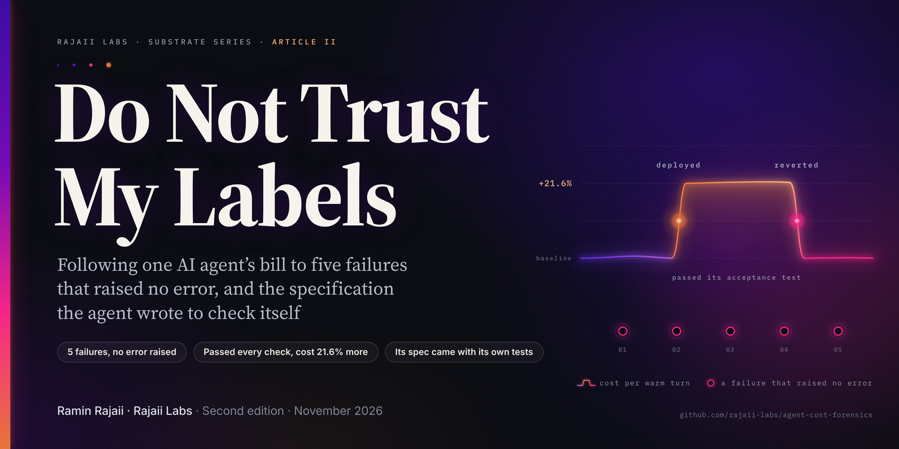

# Do Not Trust My Labels



**Following one AI agent’s bill to five failures that raised no error, and the specification the agent wrote to check itself.**

Rajaii Labs · Substrate Series · Article II · November 2026

Substrate is a production AI agent built on Claude that I have run for one user, me, since April 2026; its memory, its record of facts and its standing instructions live outside the model, so the model can be replaced and the agent stays. Its parts are built not to crash, so a part that fails quietly raises no error. In July 2026 I followed its bill, the cost recorded for every call, for two weeks: five defects came to light that no error, test or dashboard had caught, four through what they cost, among them a component silently cutting off 26 of its 51 runs and an alert that blamed a false cause six times out of six. Separately, a fix of mine meant to cut costs passed every test and made a mid-conversation reply 21.6% more expensive, because the provider's cache matches the start of a prompt by position and the fix moved part of it. In the same weeks the agent, newly allowed to act on its own between conversations, specified read access to its own stores, saying only I had caught its errors, and told whoever would build it to check every table name against the real database: "Do not trust my labels."

**Second edition, November 2026.** The first edition, published in July 2026, is kept unchanged in [archive/first-edition](./archive/first-edition/README.md) and at the tag [`first-edition`](https://github.com/rajaii-labs/agent-cost-forensics/tree/first-edition). This edition keeps its findings, applies the corrections later articles printed, and keeps every old section number as an anchor.

**[Read the PDF](./Substrate_Cost_Forensics.pdf)** · **[Read the full text (Markdown)](./Substrate_Do_Not_Trust_My_Labels.md)** · **[The first edition](./archive/first-edition/README.md)** · **[Sources](./sources.md)**

**The Substrate series:** [Article I](https://github.com/rajaii-labs/agent-eval-methodology) · Article II, this paper · [Article III](https://github.com/rajaii-labs/substrate-preconditions) · [Article IV](https://github.com/rajaii-labs/substrate-choices) · [Article V](https://github.com/rajaii-labs/substrate-recursion)\
**How to cite:** Rajaii, R. (2026). *Do Not Trust My Labels: Following one AI agent’s bill to five failures that raised no error, and the specification the agent wrote to check itself* (2nd ed.). Rajaii Labs, Substrate series, Article II. [BibTeX](#citation) · [CITATION.cff](./CITATION.cff)

---

## What is in the paper

**The story**, sections 1–7, about 8,500 words:

- **The opening.** The change that made replies dearer, the main point, the thesis, and one observation per finding that would prove it wrong.
- **1. An agent built not to crash fails without an error, and its bill still charges for every call that completes.** Why a quiet failure is ordinary, what four outside sources found, and the bill as the one signal that survives.
- **2. Substrate keeps one agent's memory outside its model, so the agent can read its own design, and every turn pays to send that memory to the model.** The system, where the money went (Figure 1), and the series.
- **3. Five failures that raised no error came to light, four of them through the bill, and the bill's own record had a blind spot.** The $4.176 reply, the five failures (Figure 2), and a failover billed twice and recorded once.
- **4. Allowed to act on its own, the worker passed all four go-live conditions, and none could tell me whether its decisions were right.** The grant and its rails, and the specification the agent wrote for its own interior.
- **5. My fix passed its 335-line acceptance test, and the cache wrote the moved block afresh on every turn, because it matches by place as well as by bytes.** The move, the probe and the regression (Figure 3), and seventeen corrections to my own figures.
- **6. The bill works as a correctness check only where failure costs money, and the largest saving on offer was one I refused.** The refused lever, the cost that remains, and what it means for builders and for work on autonomy.
- **7. Of twenty-seven claims, fourteen held, seven hold only with a stated limit, two were refuted by later articles, and four remain open.** Every headline claim beside the observation that would refute it, and what Articles III, IV and V printed since.

**Technical sections**, T1–T18: the system in July 2026; autonomy graded and the rails; the agent's specification, as excerpted; the five defects in full; the failover that can bill twice; the $4.176 reply and the spend; the census of the context; what invalidates a warm cache; the move, the probe and the regression; why it could never have worked; what worked instead; cache warming, rejected; the seventeen-row ledger; cost on both bases; open problems; the lessons; what changed in this edition, with a map from every first-edition section; the glossary.

**Beside the paper.** The [sources](./sources.md) the story cites, with the date each was read; the [figures](./figures/) and the title-page mark, as SVG and PNG files; the [first edition](./archive/first-edition/README.md), unchanged, with its [PDF](./archive/first-edition/Substrate_Cost_Forensics.pdf).

## The Substrate series

1. **Recall, Negation, Abstention** — Rajaii Labs, July 2026 · second edition, November 2026. [Repository](https://github.com/rajaii-labs/agent-eval-methodology)
2. **Do Not Trust My Labels** — Rajaii Labs, July 2026 · second edition, November 2026. *This paper.*
3. **Preconditions** — Rajaii Labs, August 2026 · second edition, November 2026. [Repository](https://github.com/rajaii-labs/substrate-preconditions)
4. **Choices** — Rajaii Labs, October 2026 · second edition, November 2026. [Repository](https://github.com/rajaii-labs/substrate-choices)
5. **Recursion** — Rajaii Labs, November 2026. [Repository](https://github.com/rajaii-labs/substrate-recursion)

## Citation

```bibtex
@techreport{rajaii2026labels,
  author      = {Rajaii, Ramin},
  title       = {Do Not Trust My Labels: Following one AI agent’s bill to five failures that raised no error, and the specification the agent wrote to check itself},
  institution = {Rajaii Labs},
  year        = {2026},
  month       = nov,
  edition     = {Second},
  note        = {Substrate series, Article II. Second edition, November 2026; first published July 2026.}
}
```

The same metadata is in [`CITATION.cff`](./CITATION.cff), which GitHub's "Cite this repository" reads.

## Contact

Architecture and methodology questions welcome: **ramin@raminrajaii.com** · [linkedin.com/in/raminrajaii1](https://www.linkedin.com/in/raminrajaii1) · ORCID [0009-0009-5517-6701](https://orcid.org/0009-0009-5517-6701)

© 2026 Ramin Rajaii. All rights reserved. See [LICENSE.md](./LICENSE.md).
