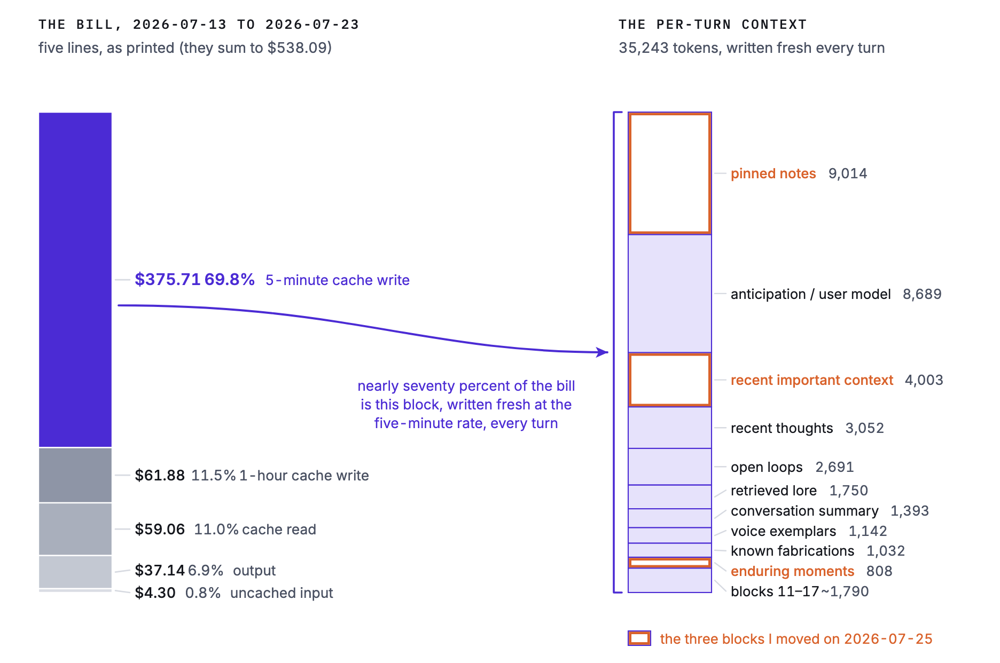
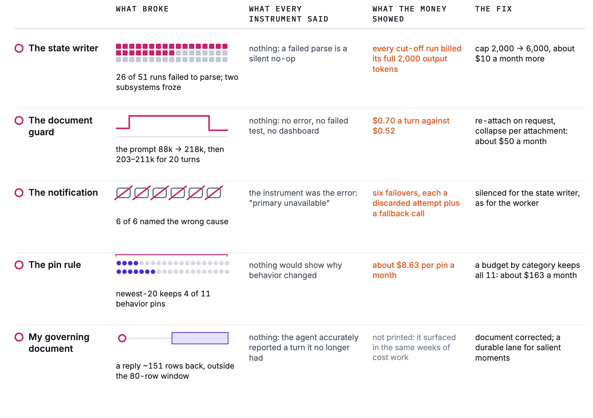
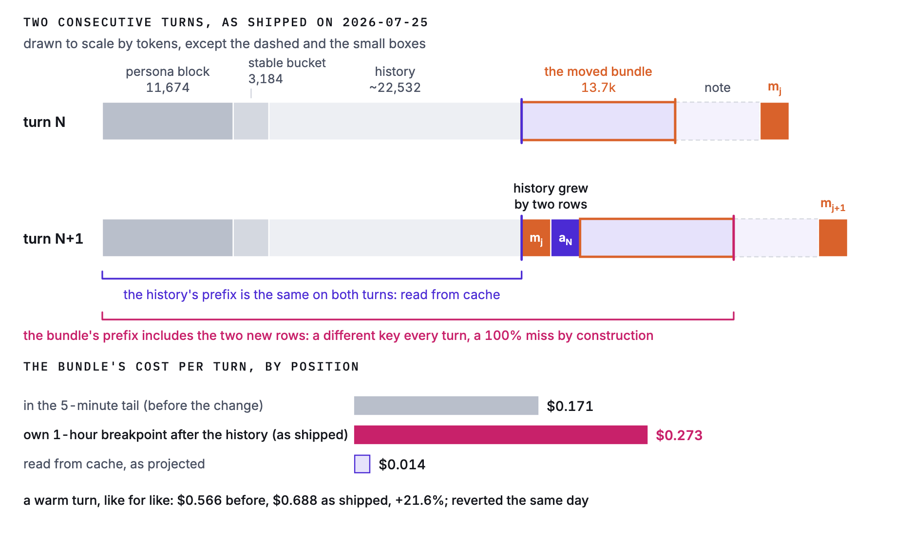

# Do Not Trust My Labels

**Following one AI agent’s bill to five failures that raised no error, and the specification the agent wrote to check itself.**

```
Ramin Rajaii — Rajaii Labs
ramin@raminrajaii.com · linkedin.com/in/raminrajaii1 · ORCID 0009-0009-5517-6701
November 2026
```

Rajaii Labs · Substrate Series · Article II · November 2026

Second edition · November 2026 · first published July 2026

*Substrate series:* [**Article I**](https://github.com/rajaii-labs/agent-eval-methodology) *·* [**Article III**](https://github.com/raminrajaii/substrate-preconditions) *·* [**Article IV**](https://github.com/raminrajaii/substrate-choices) *·* [**Article V**](https://github.com/raminrajaii/substrate-recursion)

---

<!-- STORY START -->

On 2026-07-25 I shipped a change to the AI agent I run. It was meant to make every reply cheaper, and it had passed every check in a 335-line acceptance test. Its first four replies cost $2.03, $0.85, $0.69 and $0.81, against the $0.48 I had projected, and I reverted it the same day.[^s-open]

Not all of that was the change. One of the four came after a silence of more than three hours, long enough for the saved start of the prompt to expire and be paid for again, a cost the first edition counts as ordinary and not the change's. Compared like for like, a mid-conversation reply that needed a single call to the model cost $0.566 before the change and $0.688 after it, 21.6% more, though only one of the four replies after the change was of that kind.[^s-open2]

Substrate is a production AI agent built on Claude that I have run for one user, me, since April 2026; its memory, its record of facts and its standing instructions live outside the model, so the model can be replaced and the agent stays. Its parts are built not to crash, so a part that fails quietly raises no error, and logs, tests and dashboards stay clean. But the model's provider bills every call that completes, whether or not its result was any use, so in July 2026 I followed the money. In two weeks, five defects came to light that no error, test or dashboard had caught: among them a component whose output limit was silently cutting off 26 of its 51 runs, an alert that blamed a false cause six times out of six, and a rule in my own project instructions that had been false for two months. A cost cut of mine, which moved part of the agent's memory to a new place in the prompt, passed every test and made a mid-conversation reply 21.6% more expensive, because the cache matches content by position. Of seventeen corrections I made to my own cost figures, sixteen were about what a number measured. In the same weeks the agent, newly allowed to act on its own between conversations, specified read access to its own stores and warned whoever would build it, in the words of this paper's title: "Do not trust my labels."[^s-main]

Because its provider bills every call that completes, whether or not its result was any use, two weeks of following this agent's bill brought to light five failures that raised no error, four of them through their cost, and showed that a test of mine had checked the wrong property; the agent's own specification asked for the same kind of outside check on its claims about itself.[^s-thesis]

Three observations would prove it wrong; the full table of claims is in [§7](#7-of-twenty-seven-claims-fourteen-held-seven-hold-only-with-a-stated-limit-two-were-refuted-by-later-articles-and-four-remain-open).[^s-three]

- **Five defects went uncaught** would fall if an error, a failed test or a dashboard had flagged any of the five before the cost work did. The false alert is one of the five: it named the wrong cause every time.
- **A change can pass every test and still make replies cost more** would fall if, while the change was live, any reply had read the moved memory from the cache instead of writing it again. All four replies after the change wrote it.
- **The agent specified its own safeguard** would fall if the instruction to check every name against the real database, or the two tests (every write refused, existing access unchanged), came from me, not the agent.[^s-fals]

## Contents

- **The story.** [1. An agent built not to crash fails without an error, and its bill still charges for every call that completes](#1-an-agent-built-not-to-crash-fails-without-an-error-and-its-bill-still-charges-for-every-call-that-completes) · [2. Substrate keeps one agent's memory outside its model, so the agent can read its own design, and every turn pays to send that memory to the model](#2-substrate-keeps-one-agents-memory-outside-its-model-so-the-agent-can-read-its-own-design-and-every-turn-pays-to-send-that-memory-to-the-model) · [3. Five failures that raised no error came to light, four of them through the bill, and the bill's own record had a blind spot](#3-five-failures-that-raised-no-error-came-to-light-four-of-them-through-the-bill-and-the-bills-own-record-had-a-blind-spot) · [4. Allowed to act on its own, the worker passed all four go-live conditions, and none could tell me whether its decisions were right](#4-allowed-to-act-on-its-own-the-worker-passed-all-four-go-live-conditions-and-none-could-tell-me-whether-its-decisions-were-right) · [5. My fix passed its 335-line acceptance test, and the cache wrote the moved block afresh on every turn, because it matches by place as well as by bytes](#5-my-fix-passed-its-335-line-acceptance-test-and-the-cache-wrote-the-moved-block-afresh-on-every-turn-because-it-matches-by-place-as-well-as-by-bytes) · [6. The bill works as a correctness check only where failure costs money, and the largest saving on offer was one I refused](#6-the-bill-works-as-a-correctness-check-only-where-failure-costs-money-and-the-largest-saving-on-offer-was-one-i-refused) · [7. Of twenty-seven claims, fourteen held, seven hold only with a stated limit, two were refuted by later articles, and four remain open](#7-of-twenty-seven-claims-fourteen-held-seven-hold-only-with-a-stated-limit-two-were-refuted-by-later-articles-and-four-remain-open) · [The ending](#the-ending)
- **Technical sections**, [T1–T18](#technical-sections), hold the receipts for every claim, the lessons, what changed in this edition with a map from every first-edition section, and the glossary. Then the [references](#references).

Each term is explained where the story first uses it, and all of them are in the glossary, [T18](#t18-glossary-data-and-interests).

---

## 1. An agent built not to crash fails without an error, and its bill still charges for every call that completes

The parts that keep an AI agent answering are built to absorb their own failures. A parser that receives a malformed answer refuses it and records the safe choice. A background writer hands off its work and does not wait to see it land. Two modules that read the same output are walled off from each other, so that a bad result in one cannot sink the other. A cache optimization that would break a request is dropped, and the request goes on. Each of these is the right design, and each takes away an error message. When something fails behind one of them, the agent goes on replying and nothing raises an error.[^s1-shapes]

Studies of production software find this pattern behind the worst outages. Yuan and colleagues read 198 user-reported failures of five widely used distributed data systems built to tolerate the failure of their parts. In 92% of the catastrophic ones, the software had signaled a non-fatal error and then handled it wrongly, and in a quarter of them the handler ignored the error or only logged it.⁵ Writing about machine-learning systems in production, Sculley and colleagues warned that in a changing world, tests of components and of running systems "are not sufficient to provide evidence that a system is working as intended", and asked the question this paper takes up for one agent: "what to monitor?"⁴[^s1-field]

Agents raise the stakes, because an agent that acts on its own works where nobody is watching. Anthropic's guidance for people building them warns: "The autonomous nature of agents means higher costs, and the potential for compounding errors."¹ Kapoor and colleagues add that "Agents can cost much more than a single model call", and argue that evaluations should count dollar costs rather than proxies for cost.³[^s1-agents]

One signal survives every design above. The provider charges for every call that completes, useful or not, so a run that produced nothing still leaves a charge. That makes the bill an instrument for correctness as well as for cost, which the first edition put as its twelfth lesson: "Cost telemetry is a correctness instrument."[^s1-bill]

This paper is the case of one agent, in the weeks when I first let part of it act on its own. The four go-live conditions I had set for that grant all passed, and all four were things an instrument can measure. Following the agent's bill in the same weeks led to five failures nothing else had caught, and to a fix of mine that passed every test and made replies dearer.[^s1-now]

Two limits belong here, before any finding. A failure that costs nothing leaves no charge, so the bill shows only the failures that spend money. And the bill as the provider counts it is one thing and my record of it another: the record this system kept had a blind spot of its own, which §3.1 describes.[^s1-limits]

## 2. Substrate keeps one agent's memory outside its model, so the agent can read its own design, and every turn pays to send that memory to the model

Substrate is a production AI agent built on Claude that I have run for one user, me, since April 2026; its memory, its record of facts and its standing instructions live outside the model, so the model can be replaced and the agent stays. In July 2026 the model was Claude Fable 5 on every turn, with Claude Opus 4.8 as the backup when a call failed over. The first edition said the agent's identity and memory had survived three model generations; Article IV later found that this rests on my configuration record, not on the stored rows. I am the system's one user, its operator, the founder of the company whose product it is and the author of this paper, and every count here should be weighed with that in mind.[^s2-what]

Keeping the agent outside the model makes two things possible that this paper relies on. The agent can read its own architecture: a read-only query tool it can call while answering, reported in Article I, lets it look a fact up before asserting it. And every turn is stored with what it cost, so the money can be followed from the bill to the part of the prompt that spent it. That record is the system's own, the token counts the provider returns priced at its list rates; it was not reconciled with the provider's invoice (§3.1).[^s2-possible]



*Figure 1. Where the money went. Left, the bill for 2026-07-13 to 2026-07-23 in the five lines the first edition prints; they sum to $538.09, against a window total of $540.15 (an open erratum, [T17](#t17-what-changed-in-this-edition-three-corrections-eight-later-states-six-open-errata)). Right, the per-turn context drawn to scale by tokens: nearly seventy percent of the bill is this block, written fresh at the five-minute rate every turn. The three blocks I moved on 2026-07-25 are outlined (§5). Four of these blocks, the pins, the user model, the recent thoughts and the open loops, come from stores the agent could not read in July 2026; its specification asked for read access to them (§4.1). Sources: first edition §6, §13 and §14 ([T3](#t3-the-agent-knew-its-architectures-history-better-than-i-did-and-its-specification-guarded-against-its-own-labels), [T6](#t6-the-4176-reply-was-a-cold-rewrite-after-a-17-minute-gap-and-nearly-seventy-percent-of-the-bill-was-one-line), [T7](#t7-a-census-of-the-context-found-three-kinds-of-volatility-and-instrumenting-writes-sees-only-one)).*

It also has a price. The model keeps nothing between turns, so the agent's memory has to be sent to it on every turn: in July 2026, a block of about 35,000 tokens assembled fresh for each message, the per-turn context. The provider can cache a prompt it has just seen and charge a tenth of the input price to read it back, but this block changed from turn to turn, so it was written to the cache anew each time, at a quarter above the input price. Over ten days that one line of the bill was nearly seventy percent of the total (Figure 1).[^s2-cost]

This is the second of five papers on Substrate. Article I (July 2026) set out a field method for catching hallucination, contradiction and drift in the agent's replies, and the code that checks the agent's claims dates from it. This paper grades the autonomy grant Article I promised and prints a build specification the agent wrote for read access to its own interior, the first such specification this series printed. It was not the agent's first: Article V later found, by a keyword search of the agent's messages, 69 specifications of its own system written outside the lists of requests that paper studies, the first on 2026-04-24.[^s2-series] Article III (August 2026) asked which preconditions of machine self-awareness can be built; Article IV (October 2026) tested ten choices nominated as the agent's own against the record; Article V (November 2026) followed the agent writing 59 requests for its own upgrades, 35 of them built by 2026-11-09. Their corrections to this paper are applied where the claims sit and listed in [T17](#t17-what-changed-in-this-edition-three-corrections-eight-later-states-six-open-errata).[^s2-later]

## 3. Five failures that raised no error came to light, four of them through the bill, and the bill's own record had a blind spot

The question that started the work was why a first reply after a silence could cost eight times a normal one, and I had an answer ready. The cached start of the prompt lives for an hour, and I assumed a long enough silence let it expire, so that the next reply had to write the whole prompt again.[^s3-expected]

The record said otherwise at the first number I checked. One such reply cost $4.176. Its stored row reconciles to the cent, its token counts times the list prices giving its recorded cost, and shows the whole prompt written to the cache from scratch on the turn's first call to the model. But the silence before it had lasted 17 minutes, well inside the hour. Two other signals fired on the same turn, and the stored rows cannot separate them, so the cause of that one reply stays open. Expiry after a silence turned out to be real and small, under four percent of the ten days' spend.[^s3-reply]

> **Under the hood.** How the cache is billed decides everything that follows. Reading a prompt back from the cache costs a tenth of the normal input price. Writing it to the cache costs a quarter more than input for an entry that lives five minutes, and twice input for one that lives an hour. A turn that finds the start of its prompt in the cache, a warm turn, reads that part back at the low rate; a turn that must write the whole prompt again, a cold one, can cost several times as much for the same words. The rates are as of 2026-07-25; [T6](#fe-13) reconciles the $4.176 reply line by line.[^s3-uth-cache]



*Figure 2. Five failures that raised no error. Each lane draws the failure's shape, then what every instrument reported, what the money showed and the fix. The notification is one of the five, not an exception to them: it fired, and named a false cause each time. The fifth lane's money cell says that the first edition prints no cost signal for that defect. The dollar figures are monthly estimates, each computed at the turn volume of the record it comes from. Sources: first edition §8 to §11 and §19 ([T4](#t4-five-defects-raised-no-error-and-the-first-edition-names-a-cost-signal-for-four-of-them)).*

What it changed was the question. I stopped asking why one reply was dear and asked what each line of the bill was paying for. Following the money through the system in those two weeks turned up five failures that had raised no error, four of them through what they cost. Each is told here by how it came to light (Figure 2).[^s3-five]

**A writer was failing about half the time, and the search for failovers found it.** I was looking for why the backup model answered almost one turn in eight, and expected the main chat replies to be running out of room under their output cap; the mechanism was right and the part was wrong. A separate call, the state writer, records the agent's current state, and its output was capped at 2,000 tokens. The model's reasoning used up the cap before the answer was finished: 26 of 51 logged runs produced text that could not be parsed, in a sample the first edition also gives as 50 runs. The failed parse was stored as nothing to update, and a second writer that parses the same text failed with it. Every layer behaved as specified, and the runs cost money and produced nothing. The cap went to 6,000, a correctness fix that costs a little more each month; its verification had not been run when the first edition was published.[^s3-writer]

**One document kept every image beside it at full size.** Documents were exempt from the rule that shrinks old attachments to short stubs. A figure saying they drove about a fifth of the bill had named the work, but it counted all spend on turns that merely had a document in view; the excess the documents caused was about 3.6% of spend. The larger finding sat beside it: the exemption applied to the whole message, so one document kept every image sent with it at full size for as long as the document stayed. It came to light because the money was in the wrong place. The fix keeps a document whole for its own turn and the agent's next two replies, then shrinks it to a stub that names a tool to bring it back, and only if it can be brought back; it had not yet been tested on a live document when the first edition was published.[^s3-doc]

> **Worked example: one word of code between a fix and a loss.** The document fix first counted my messages to decide when a document could shrink. But three messages sent in quick succession after a document are my normal pattern, and they shrank the document before the agent had replied once. A second build session caught it, and the count was rewritten as a new function over the agent's replies. The quick repair, changing one word in the old loop so that it counted replies, would have been worse: the loop's lookup table was keyed by the agent's replies, so every lookup for one of my messages came back empty, the empty value counted as infinitely old, and every document would have shrunk at once. Neither version would have raised an error. [T4](#fe-9) has the detail.[^s3-worked]

**An alert blamed the wrong cause six times out of six.** The state writer's runs that returned almost no text were handed to the backup model, and each of those six failovers sent me a notification that the main model was unavailable. It was available; the calls had run out of tokens. The detector behind the alert looks up which model served the previous message, in a table the state writer never writes to, so every one of its failovers looked like a new outage: plain control flow, and no model, produced a wrong cause stated with confidence. The alert was silenced for that writer, as it already was for the background worker, which removes the false alarm and any alarm on that writer's failovers with it; the first edition reports no other fix.[^s3-alert]

**The obvious trimming rule would have dropped seven of the eleven notes that shape how the agent acts.** The agent keeps short notes in view on every turn, its pins, and in July 2026 all 40 were sent on every turn, the largest block of the per-turn context. The obvious cut keeps the newest 20. It would have dropped seven of the eleven pins that shape behavior, and nothing would have shown why the agent then behaved differently: a note it can look up can leave its view, but a directive it no longer sees, it will not know to ask for. The rule was caught before it shipped, and the first edition counts it among the five; a budget that chooses pins by category kept all eleven. It came to light because the pins were the largest block on the bill.[^s3-pins]

**My own project instructions stated a rule that had been false for two months.** I sent a message with several images, and the agent replied in full. Under four hours later the exchange was gone from its context, and the agent said, accurately, that it did not remember it. I assumed compaction, the summarizing of older history, had removed it, but the reply had fallen out of the fixed window of recent rows the system fetches each turn, before compaction or its protections ever saw it. The defect was in the project's governing document, the file every future build session reads first: it said that conversation history is never compressed, two months after a commit had switched compaction on. It was corrected in the same session, and a separate lane now keeps important exchanges in view past the fetch window (§4.1). The first edition files this defect with the other four under what the money found, but names no cost signal for it.[^s3-rule]

> **Under the hood.** A new cap cannot be sized from runs cut off at the old one: 2,000 is the wall, not the demand, and the runs that succeeded are by definition the ones that fit under it. Data cut off at a threshold, called censored, cannot say how far past it the true values lie. The first edition took its evidence from a path that was never cut off, the chat path, a different task on the same model with a cap four times as high, and set the new cap at three times the old. [T4](#fe-8) has the three bases proposed and why two failed.[^s3-uth-cap]

### 3.1 The bill's own record had a blind spot: a failover can be billed twice and recorded once

When the main model fails and the backup answers, the system stores one row for the turn, and the first attempt appears in no column, because the code that handles the failover never receives what that attempt cost. Where the first attempt produced a response, as a refusal or a run cut off at its cap does, the provider bills both calls, by the first edition's inference from how the API bills, and my record shows one. The first edition put that unrecorded spend at about $124 over the 23 days of failover records, modeled rather than measured, and called it an upper bound that should not headline anything: it multiplies every failover by one average cost, including the kinds that bill nothing.[^s31-blind]

The second-order effect matters more. Turns the backup answered look cheaper in my data than they were, because only their second half is recorded, so every comparison of cost by model leans the same way, some in this paper among them. The repair, carrying the first attempt's cost into the stored totals, was not built when the first edition was published, and until it is, my record of the bill will not reconcile with the bill.[^s31-effect]

## 4. Allowed to act on its own, the worker passed all four go-live conditions, and none could tell me whether its decisions were right

The grant this paper reports went to the agent's background worker, a process that runs apart from the conversation: it writes the agent's state, tends its own open loops (the unresolved threads it keeps track of), keeps a journal and can propose reaching out to me. Article I had set four go-live conditions for letting it act: a wake cadence that stays stable, a sane rate of proposed actions, daily cost inside its projected band under a hard ceiling, and structured output that parses.[^s4-expected]

The first edition measured the four a week into live operation, after the grant, across 190 wake-ups of the worker, called ticks, of which 20 ran live and the rest in shadow mode, where it decides but acts on nothing. All four passed, against bars the first edition does not quantify: the worker woke at a steady rate, six ticks proposed reaching out, the two that ran live delivered real messages through the existing gate (the check every outgoing message passes), the run cost $30.36 without hitting its ceiling, and no new parse errors appeared. The first edition's reading of that result is the finding: the four are "exactly the four things you can check with an instrument, and exactly the four things that do not tell you whether the decisions were right." The first edition grades no decision.[^s4-record]

One failure already in the system shows the gap. When the decision parser on the path that sends messages receives a malformed list of message segments, it refuses it and falls back to not sending, the safe choice. The worker logs that outcome as a decline, with no alert and no retry; only a separate value in the logged decision, "errored", marks the 35 such decisions among the 788 on that path at the snapshot. The count did not grow in the window, but the class remains: a defect in the pipeline that looks like a decision.[^s4-errored]

The first week added a second blind spot. The worker's wake payload, the context it wakes up with, was widened to carry 72 hours of its own recent journal entries, and its daily cap on journal entries was raised after it reached the cap twice in one day and reported it, with the test named in advance: "if the additional entries stay substantive the change stands, and if they come out thin or circular that is the tell." The two changes tighten a loop in which the worker reads what it wrote, and no counter can see inside it, since redundant and substantive entries produce the same count, cost and parse rate. So the watch on the change was me reading the entries, and the first edition reports no reading against that test.[^s4-loop]

What it changed was how I read a pass. The four conditions showed that the machinery ran as designed. They could not show that its judgment was sound, and they could not show a failure that looks exactly like correct behavior.[^s4-changed]

> **Under the hood.** Rails were in place, though the first edition reports none of them firing. A kill switch is a database row read fail-closed: if the worker cannot confirm that it is enabled, it does not act. A daily spending ceiling is summed from stored rows, so a restart cannot reset the meter. As spending nears the ceiling, a lower floor trips first and the worker's extra reads come back empty, so it gets less capable before it goes silent. It has no send path of its own: a reach-out goes through the existing gate, which decides again with fresh context. Its own journals and open loops are kept out of the records the claim checker compares the agent's claims with, so that nothing the agent writes about itself can certify its own claims, a rule a later change loosened (Table 1). The checker does not run on the worker's output; what the worker sends is checked at the gate. [T2](#fe-3) lists every rail.[^s4-uth]

### 4.1 It then specified read access to its own interior, and told whoever built it not to trust its labels

Self-visibility was built for honesty: the read-only query tool lets the agent look up its own records before asserting a fact. In July 2026 it covered five categories of table, among them message history and stored facts, and none of the agent's own interior, such as its state, its pins and its journal. In this window it also gave the agent ideas for its own design.[^s41-expected]

The fix for the lost turn of §3 keeps important moments in a separate lane that survives the fetch window, and two of its design calls came from the agent's account of its own history, not from mine. One was to mark notable moments as they happen, instead of reviving a layer that had tried to pick them out afterward and had been abandoned. The other was to reuse an existing tag column instead of adding a mechanism. It was right about the history and wrong about one detail: it took the tag column for free text, but the column accepts only a fixed list of values, so the change needed a real database migration, and then a second.[^s41-history]

By the end of the window, asked for one, it had written a build specification for read access to its own interior: its state table and that table's history, the store that holds its model of me, the full pin store, its open loops, its journal and the store of the outside news feed it reads, all under the existing read-only validator. The request that asked for it is not printed. I pasted the specification into the build session unchanged and approved the result before it shipped.[^s41-spec]

The first edition judged it as a specification, by four properties anyone can check against the text. The first is a guard against its own known unreliability. It names its stores by function and then forbids the builder from trusting the names.[^s41-guard]

**From the agent's specification, as excerpted**

> Describe these by function, not by guessing schema names. Verify every table and column name against the real schema before wiring anything. Do not trust my labels.

The first edition reads the guard as the schema mistake above, turned into a standing instruction: having once been wrong about a schema, at the cost of a migration, the agent tells its builder to check every name it gives against the database. The guard is also an admission that it had been wrong before.[^s41-guard2]

The second keeps a seal in place. The store that holds the agent's model of me is closed to me by design, so that a model of a person cannot be read by the person it models. The specification gives the agent read access to that store, keeps me out of it, and forbids the build from creating any path by which that model could reach me.[^s41-seal]

The third is its rationale, a root-cause argument.[^s41-third]

**From the agent's specification, its stated rationale**

> Four unsourced-claim misses this week — every one caught only because the operator asked a plain question. My error-detection currently lives entirely on his side of the glass.

The first edition read this as the paper's own argument arriving from the agent's side: "a class of error is undetectable from inside and the fix is to move the detector, not to try harder." Here the detector moves from the agent's recall to the record it can query. Article V later graded the count of four misses unverifiable.[^s41-rationale]

The fourth is its acceptance criteria. Of five, three check capabilities, and the other two are a negative test and a regression assertion: "any attempted write to these tables must reject at validation", and "existing five-table access must be byte-for-byte unchanged". Article I's eighth principle is that "every fix ships with a standing regression probe"; here the agent applied it to a change in its own interior.[^s41-tests]

The first edition printed three bounds on the specification. The first was that "The specification is unbuilt as of writing, so its quality *as a specification* is assessable and its correctness is not." The others are that the guard exists because the agent had been wrong about schema before, and that reading all forty pins lets it see which notes the budget of §3 leaves out of view, adding to the pull described in §6.4.[^s41-bounds]

Article V later corrected the first bound from this paper's own history. The specification came in two messages, and the build landed between them, so it did not wholly precede its build. In Article V's words, where "II" is this paper: "the build landed between its two messages; every passage II quotes was in II's text 24 minutes before the second." This edition derives nothing further from that sentence, and the printed record does not say which message was pasted when.[^s41-vcorr]

Article III added two more bounds: the agent "was *asked* for this specification", so that one artifact produced under instruction "is evidence of a capability, not of an autonomous engineering program"; and "authorship is a variable, not a halo."[^s41-iii]

My own part in the build came to four functions: transport (carrying the specification into the build), implementation, review and the gate. The first edition named three; Article III found from the shipped record that implementation had been folded into transport and review.[^s41-role]

The first edition was careful about what this shows: "What follows is a claim about who writes the specifications and what properties those specifications carry. It is not a claim about cognition." What it changed was this paper's title.[^s41-changed]

## 5. My fix passed its 335-line acceptance test, and the cache wrote the moved block afresh on every turn, because it matches by place as well as by bytes

The census of the per-turn context (Figure 1) showed three blocks that rarely changed: the pinned notes, the recent important context (the last 20 session notes) and the enduring moments (the salient turns the system keeps in view), 13,825 tokens together, 39% of what was written fresh on every turn. I planned to move them to a cached position, where a warm turn would read them back at a tenth of the input price instead of writing them at a quarter above it, and projected a turn at $0.48.[^s5-plan]

The unit of the decision was the rate of cache loss at which the move stops paying. Placed in the cached block at the front of the prompt, the blocks would force a rewrite of the whole history behind them each time they changed, so the saving shrank as prompts grew; they went into a cache position of their own after the history, the placement with the largest saving and the only one that did not depend on the prompt's length. That analysis priced the loss from edits to the blocks; as this section shows, the loss came from their position.[^s5-placement]

Review caught one silent loss before the ship: the path that sends unprompted messages expected the old format of the data it was handed, so the move would have stripped the agent's pinned notes and its floor of the last seven days' memories from every unprompted message. Then the acceptance test ran: 335 lines, with the baseline captured before any edit. It checked that the moved block, the bundle in the figures, rendered byte-identical from turn to turn, that the history before it stayed byte-for-byte the same when the block changed, that the content matched the old content exactly, and that the number of cache breakpoints, the marks that end a cached prefix, stayed at four, the provider's maximum. It passed cleanly.[^s5-probe]

Two checks the plan had set were not met. Its own gate said to measure how often the pins were edited or removed before anything moved; the log lines that would count it shipped, and the move followed about 23 hours later without a single figure from them. And the build report asked for the saving to be confirmed from live logs, which the move did not wait for.[^s5-gate]

It shipped on 2026-07-25 and went live two to four minutes later. The first four replies after it cost $2.03, $0.85, $0.69 and $0.81. The sample of turns I first analyzed also held two turns from before the deploy: the change went live inside the sample, and a median across both architectures read as no change at all. Split at the deploy and widened to 40 turns, the record was plain. Before the change, by the first edition's count, 6% of turns made a large one-hour cache write; after it, all four did. The moved block was written to the cache at the one-hour rate on every turn and never read back.[^s5-record]

Priced by position, the block cost $0.171 a turn where it had been, $0.273 where I put it, and $0.014 where I projected it, read from the cache, so the block alone cost $0.102 a turn more than doing nothing. Like for like, a warm turn that made one call to the model went from $0.566 to $0.688, 21.6% more, a rise of $0.122. The block accounts for $0.102 of it; the first edition calls the two an exact match without showing how (an open erratum, [T17](#t17-what-changed-in-this-edition-three-corrections-eight-later-states-six-open-errata)). The 21.6% rests on the one comparable turn after the change, and the first edition prints no spread for the $0.566. What does not depend on the sample is the layout of the prompt, which makes the miss certain; four of four is what it predicts.[^s5-cost]

The cause was in how the cache is keyed, and Figure 3 draws it. The provider's documentation states it: "Because the hash is cumulative, covering everything up to and including the breakpoint, changing any block at or before the breakpoint produces a different hash on the next request."² Every turn adds two rows to the history, and the moved block sat after the history, so the prompt up to the block was different on every turn. The block could never have been read from the cache. My test had checked its bytes, which were identical from turn to turn; the outcome depended on its place in the stream, which changed every turn. The first edition's first lesson states the general form: "Content identity is necessary; position identity is the invariant."[^s5-why]

The documentation had said what to do, in advance: "For a prompt with a varying suffix (timestamps, per-request context, the incoming message), place the breakpoint at the end of the static prefix, not on the varying block." The first edition is plain that this was no gap in the documentation. My acceptance test checked the wrong property: the sentence describes the stream of requests, and the test measured one block.[^s5-docs]



*Figure 3. Why it could never have worked. The cache is keyed on the whole prompt up to a marked block, and the moved bundle sat after a history that grows by two rows every turn, so its key changed on every turn. Drawn to scale by tokens, except the dashed box (the per-query note) and the small boxes (the two new rows and the newest message). Bars give the bundle's cost per turn in each position; the +21.6% rests on the one comparable turn after the change. Sources: first edition §16 and §17 ([T9](#t9-the-move-passed-a-335-line-acceptance-probe-and-cost-0102-a-turn-more-than-doing-nothing), [T10](#t10-the-moved-block-could-never-have-been-read-from-cache-because-the-history-in-front-of-it-grows-every-turn)).*

The telemetry could not see the failure either: of two fields added to watch the block, one reported only that the cache mark was applied, true on a hit and on a miss, and the other was a character count, the same on every turn. The column that could tell a read from a miss, the count of tokens written at the one-hour rate, already existed.[^s5-fields]

What it changed was the ranking of the work. I reverted the change the same day, and three smaller fixes shipped that day instead, none of them a new cache position: the pin budget of §3, the document fix, and a coarser "days ago" string in the cached persona block, the standing instructions sent at the start of every prompt, so that the block changes on far fewer days. They were estimated at about $234 a month, against a ten-day bill of $540.15, and no measured spend after the fixes is printed. The move had been ranked first, at $320 to $376 a month.[^s5-instead]

Keeping the cache warm through silences would cost about $25 a month to save about $48; I had written that up as an argument against it, a sign error caught in external review. It was still rejected, because it adds about 720 calls a month that match no stored turn, spend the record cannot see.[^s5-warming]

### 5.1 Of my seventeen corrections, one fixed arithmetic and sixteen fixed what a number measured

Across the two weeks I documented seventeen corrections to my own work and classified each by the kind of error, with no second reader. Exactly one was arithmetic: the sign in the warming case. The other sixteen, by my classification, were about what a number measured: censoring, confounding, a proxy standing in for the thing measured, a base rate taken for an effect, a unit error, survivors standing for everyone, two samples joined by inference, and a stale specification, which is a rule rather than a number.[^s51-ledger]

Several are already in this story: the two first tries at sizing the state writer's cap (§3), the document figure and the change that went live inside the sample. Another found that the token columns were summed across a turn's calls to the model, so that a raw column was not a prompt size.[^s51-examples]

The first edition drew the lesson that this story keeps: "Reviewing your own arithmetic is nearly worthless; reviewing your own construct validity is where the errors are." It says nearly every correction came from asking of a statistic whether it measured what I thought it measured, and ten of them, each found by rereading a definition, changed a conclusion. This edition's own check of the first edition cuts against the lesson's first half: of its six errata, five are counts or sums that do not add up ([T17](#t17-what-changed-in-this-edition-three-corrections-eight-later-states-six-open-errata)).[^s51-lesson]

One correction is kept at the first edition's strength, which called it the one "I am least willing to soften". I had taken images to be driving the chat path's refusals: all six chat failovers I observed carried a refusal, and turns the backup answered carried an image about half the time, against a base rate under a third. Those facts come from two different samples, a refusal says that the model declined and never why, and the cross-tabulation that would test a link had not been run.[^s51-row14]

The first edition tied the corrections to Article I's central finding, that a label such as "hallucination" can hide several different failures. A number can too: a count of one-hour cache writes comes both from a lost cache and from new content appended behind a valid one, and a share of spend on turns with a document holds the baseline as well as the excess.[^s51-label]

## 6. The bill works as a correctness check only where failure costs money, and the largest saving on offer was one I refused

### 6.1 I refused the largest saving, and the largest cost is by design

The backup model was exactly half the main model's price on every line of the bill: input, output, cache reads and both kinds of cache write. At that price the ten days' $540.15 would have been about $270, far more than the fixes of §5 saved, so switching to it for good was the largest cost lever in the system. I refused it, permanently and on the record, with a cut to the reasoning-effort setting, because in my judgment it would degrade the thing the system exists to be; the first edition printed the refusal with its price.[^s61-lever]

What remained after the fixes was the per-query tail, the part of the context rebuilt for each message, about 48% of a warm turn. It cannot be cached, because much of it is retrieved for the message at hand and is meant to change with each one. The first edition judged that it may not shrink much further without retrieving less, which the system's own invariants forbid: a fixed amount of retrieval per turn is one of the product's standing rules. The largest cost left is one the architecture deliberately keeps.[^s61-tail]

### 6.2 The largest block may also be broken

The same accounting pointed at a likely defect. The store that holds the agent's model of me decayed on every turn, so a day with 200 turns faded it 200 times and a day with five turns five times. One of its dimensions halved on every turn, so a row written with a confidence of 0.65 fell to 0.325 after a single untouched turn, under the display floor of 0.35. That dimension may be written on every turn and readable on none. The first edition printed it as a hypothesis with a named test: "The test is to read the store and check whether any row of that dimension has ever been visible at render time on a turn after the one that wrote it." It had not been run, and the block was examined only because it was expensive.[^s62-writeonly]

### 6.3 For builders, the bill finds a silent failure only when it spends money, and a test has to check the property that decides the outcome

For anyone building on a model that is paid for by the call, the twelfth lesson is the practical one, and it carries its own limit: "A defect that costs nothing produces no signal." The bill found the state writer's cut-off runs because each cost money and produced nothing, and found the document defect because the money sat in the wrong place. It would not have found a defect that spent nothing, and it does not account for the lost turn of §3.[^s63-bill]

Other rules here are cheap: find the deploy boundary before any before-and-after, know whether a column counts a call or a turn, size a limit from a run never cut off, and keep in view what the agent cannot fetch back. [T16](#fe-24) lists all the first edition's lessons, each drawn from this one system.[^s63-rules]

### 6.4 For work on autonomy, conditions that measure process cannot certify judgment, and telling an agent its own rules gives it an incentive

The four go-live conditions were all properties of the process. The first edition's eighth lesson draws the consequence, that conditions of that kind will never certify judgment, and where no counter can tell substance from redundancy, as with the worker's journal, the honest watch is a person reading.[^s64-process]

The pin budget produced a second result for autonomy. In the same commit, the tool description the agent reads was updated to say, accurately, that the identity and directive pins it files always come back. The first edition stated what follows from that: "That is an incentive for the agent to route new pins into those categories. If the lane grows past the budget the block runs over and climbs back toward 9k tokens, silently undoing the saving."[^s64-tool]

Its general form was a hypothesis about agents, written down before any data: "telling an agent the policy that governs its own context budget creates an incentive gradient in that policy's direction." An alarm shipped, set to fire when those protected pins filled 12 of the 20 slots the budget shows, one above the 11 they filled then, with the remedy named in advance. Article III later found them at 14 of 20: "The alarm's condition is now met, the pre-named remedy exists, and it has deliberately not been applied pending the growth log the instrument was built to produce."[^s64-gradient]

## 7. Of twenty-seven claims, fourteen held, seven hold only with a stated limit, two were refuted by later articles, and four remain open

Table 0 grades each headline claim, with its first-edition section number. Its refutation column and the opening's three observations are this edition's, written after the outcomes were known, and this edition measures nothing again: it reports what the first edition and the later articles printed. A claim **held** if nothing printed since contradicts it and its evidence is as stated, which is not the same as having been measured again. A claim is **limited** if it holds only with the limit in its row, whoever stated that limit. A claim is **refuted** if a later article showed it wrong as published, and the correction is printed where the claim sits. A claim is **open** if it was left unverified or untested and nothing printed since settles it.[^s7-status]

**Table 0. Each headline claim of the first edition, what would refute it, and where it stands after Article V (November 2026).**[^s7-table0]

| claim (first edition §) | what would refute it | status |
|---|---|---|
| The worker passed all four go-live conditions (§2) | a condition failing on the same snapshot | **held**: 190 ticks, 20 live, $30.36, no ceiling hit |
| None of the four can grade a decision; 35 failed decisions look like declines (§2, §7) | one of the four telling a failed decision from a decline | **held**: only a separate value in the logged decision marks the 35 |
| The agent wrote the specification: its guard, rationale and two tests (§6) | a message of mine proposing the guard or the tests first | **held**, on the specification's text and my account; the agent was asked for a specification, and the request is not printed (Article III) |
| The specification preceded its build (§6: "unbuilt as of writing") | the record of the build | **refuted** by Article V: "the build landed between its two messages; every passage II quotes was in II's text 24 minutes before the second" |
| My role on that build reduced to transport, review and the gate (abstract, §6) | the shipped record | **refuted** by Article III: four functions, because "implementation was compressed into transport and review" |
| "A self-authored surface can never certify its own factual claim" (§3) | rows the agent writes certifying or exempting its claims | **limited**: true in July 2026; since 2026-11-07, rows the agent writes can exempt one class of its claims from grading, unused at Article V's snapshot (Article V) |
| Identity and memory survived three model generations (§1, §23) | the stored rows | **limited**: the rows "neither confirm nor contradict it"; the claim "rests on the operator's configuration record, not on the store" (Article IV) |
| No error, test or dashboard flagged any of the five defects first (§1) | an error, test or dashboard that flagged one first | **held**, on the first edition's account; the false alert fired, naming a wrong cause |
| Following the money surfaced all five (abstract) | a defect found by another route | **limited**: a cost signal is named for four, none for the lost turn (first edition §11); the pin rule never shipped; no control separates the bill from my own attention |
| The state writer failed to parse 26 of 51 runs, raising no error (§8) | the same logs showing the failures raised as errors | **held**; the sample is printed as both 50 and 51 runs (an open erratum) |
| Raising its cap to 6,000 ends the failures (§8) | a re-run of the same query not showing "the parse-failure rate collapsing from 51%" | **open**: not re-run at publication or by 2026-08-14 (Article III) |
| One document held every attachment beside it at full size (§9) | an attachment that collapsed while its document stayed | **held** |
| The windowed re-attach cuts 36 re-attaches to 3, about $50 a month (§9) | the specified live test, in which the agent "should invoke the retrieval tool", failing | **open**: unverified in production by 2026-08-14 (Article III) |
| The failover notification named a false cause six times of six (§10) | one of the six coinciding with a real outage | **held** |
| Keeping the newest 20 pins would have dropped seven of eleven behavior pins (§19) | the dropped set holding no directive or identity pin | **held**; the rule was rejected before commit |
| The governing document asserted a rule that had been false for two months (§11) | compaction inactive in those two months | **held**; corrected in the same session |
| A failover can bill twice and record once, about $124 over 23 days (§12) | a stored row carrying the discarded attempt's usage | **limited**: a modeled upper bound; the weighted figure was not produced; the section's first sentence and its table disagree (an open erratum) |
| The $4.176 reply was not a cache expiry (§13) | a silence of an hour or more before it | **held**: the silence was 17 minutes; its cause stays open |
| Nearly seventy percent of the ten-day bill was one line (§13) | a re-run of the decomposition | **held**; the five lines sum to $538.09 against $540.15 (an open erratum) |
| The moved block missed the cache on every turn after the change, by construction (§16, §17) | a turn after the change reading it from the cache | **held**: all four wrote it, and the documentation states the rule |
| The change made warm turns 21.6% more expensive (§16) | a like-for-like turn after the change at or below $0.566 | **limited**: one comparable turn; the claimed exact match with the block's cost is not shown (an open erratum) |
| Two fields added to watch the block could not see a miss (§18) | either field differing between a hit and a miss | **held** |
| Three fixes recovered about $234 a month (§19, §22) | the shipped fixes saving less at the same turn volume | **limited**: estimates at different turn volumes; one share conditional and unverified, one a floor; no measured spend after the fixes |
| Sixteen of seventeen self-corrections were about what a number measured (§21) | a second reader coding more than one of them as arithmetic | **limited**: my classification alone, with no second reader; one of the sixteen, a stale document, is a rule rather than a number |
| The half-price model, the largest saving, was refused (§22) | a switch to the backup as the main model | **held**: a decision on the record |
| "Telling an agent the policy that governs its own context budget creates an incentive gradient in that policy's direction" (§19, §23) | the pin-mutation log showing no shift of new pins into those categories | **open**: the alarm sat one pin above the July count; 14 of 20 by 2026-08-14, the remedy unapplied, no cause established (Article III) |
| "That dimension may be effectively write-only: written on every turn, and unreadable by the next one" (§22) | any row of that dimension "visible at render time on a turn after the one that wrote it" | **open**: the test was "designed and unrun" at 2026-08-14 (Article III) |

**Table 1. Since this paper: what Articles III, IV and V printed about its claims and open items, and the effect on Table 0, in the first edition's order.**[^s7-since]

| first edition | what a later article printed, and its effect | where |
|---|---|---|
| §1: three model generations | the claim "rests on the operator's configuration record, not on the store"; limits it | IV §8 row 4 |
| §2, §7: the worker | 249 live ticks and $68.26 by 2026-08-14; a later state | III §35 row 9 |
| §3: "a self-authored surface can never certify its own factual claim" | since 2026-11-07, rows the agent writes can exempt one class of its claims from grading; limits it | V §4.1 |
| §6: the specification | shipped and running by 2026-08-14; "the build landed between its two messages" (refutes "preceded its build"); of its tests, "whether they ran is unrecorded" | III §21 rung 7; V T12 rows 2–3 |
| §6: my role | four functions: transport, implementation, review and the gate; refutes "three" | III §22, §35 row 13 |
| §8, §9, §12, §23: the cap's re-run, the document fix, the failover cost, §5.1's cross-tabulation | all open at 2026-08-14 | III §34 |
| §19, §22: the pin alarm; the store that models me | the protected pins at 14 of 20, the remedy "deliberately not been applied"; decay by elapsed time "applied and live", the write-only test "designed and unrun"; both stay open | III §5; III §35 row 7, §33 |

<!-- STORY END -->

## The ending

In my reading, the instruction the agent gave its builder is the rule this paper needed for its own numbers. Most of my seventeen corrections came from trusting a number's name over what it measured: a column that looked like a prompt's size but summed a turn's calls, a share of spend credited to documents that held the baseline too, and a median of turns after a change that mixed two architectures. Each was caught by asking what the number actually measured, which is the check the agent asked its builder to run on its table names. The findings above do not depend on this reading.[^s-reading]

---

*This paper is a direct continuation of* [**"Recall, Negation, Abstention: Evaluating a Production LLM Agent Against Its Own Failure Modes"**](https://github.com/rajaii-labs/agent-eval-methodology) *(Rajaii Labs, July 2026); it reuses that paper's taxonomy and cites its sections by number.*

Architecture and methodology questions welcome: `ramin@raminrajaii.com`.

© 2026 Ramin Rajaii. All rights reserved.

---

# Technical sections

<!-- TECHNICAL START -->

The sections below hold what the story leaves to receipts, each linked from the place in the story that relies on it. They carry every claim, number, table, limit and correction of the first edition, reorganized and in plainer words. Here the paper's internal labels appear: commit ids, table and column names, stop reasons and the probe populations. Each section opens by naming the first-edition sections it carries, and every first-edition section keeps its old number as an anchor (`#fe-6` reaches first-edition §6), so citations of this paper by section number still land. [T17](#t17-what-changed-in-this-edition-three-corrections-eight-later-states-six-open-errata) maps every first-edition section to its place here.

Every figure below is as of the first edition, July 2026, unless it carries another date. The cost window is 2026-07-13 to 2026-07-23. Prices and platform behavior are as they stood on 2026-07-25, the day the platform documentation was read. Figures measured later, in Articles III to V, appear only in notes and in [T17](#t17-what-changed-in-this-edition-three-corrections-eight-later-states-six-open-errata), each with its date and source.

## T1. In July 2026 the system was the one Article I measured, grown by three tables, two tools, one job and three stores

<a id="fe-1"></a>*First edition §1. Figures as of July 2026.* Substrate was unchanged in kind since Article I and larger in scope. It was a founder-operated production deployment for one principal, in continuous operation since 2026-04-23, with the same hybrid memory: episodic vector memory, a deterministic facts store that carries negations, a verbatim window of recent messages under governed compaction, and a durable raw archive. Claude Fable 5 was the reasoning core on every turn and every path. Availability failover to Claude Opus 4.8 was symmetric and edge-triggered (it switches on a change of availability in either direction) and ran through one shared implementation that every call site used. By the operator's configuration record, identity and memory had survived three successive frontier generations, Opus 4.7 to Opus 4.8 to Fable 5, plus live failover events.[^t1-gen]

| What grew | Article I | July 2026 |
|---|---:|---:|
| public base tables[^t1-later] | 51 | 54 |
| chat tools[^t1-tools] | 10 | 12 |
| scheduled jobs | 11 | 12 |

The new chat tool was a document-retrieval tool, and one tool is dropped when a daily cap is reached. Retrieval per turn was unchanged and remained a standing product invariant: one shared embedding, run concurrently, returning three lore memories, five voice exemplars, two journal entries, two images, and six semantically selected biographical facts above a 0.3 similarity threshold. The history window fetches 80 rows, holds up to 79 verbatim, triggers compaction at 40, and compacts to 25. The read-only grant in the agent's own tool loop still covered five categories of table and no interior surface ([T3](#t3-the-agent-knew-its-architectures-history-better-than-i-did-and-its-specification-guarded-against-its-own-labels) has the five, and what changed after).

Three new subsystems shipped in the same window and appear in this paper only where they carry the argument. The first is a multi-row store holding the agent's current model of the principal: probabilistic, decaying, and deliberately absent from the grounding surface the fabrication checker uses. The second is a verbatim salience lane. The third is an ambient world-feed reader. Two of the three surfaced defects.

**How the figures were made.** Every figure is measured from persisted rows unless it is labeled an estimate. Where a figure depends on which turns a probe read, the population is named, never silently averaged ([T6](#t6-the-4176-reply-was-a-cold-rewrite-after-a-17-minute-gap-and-nearly-seventy-percent-of-the-bill-was-one-line) lists them). Monthly figures were computed at the turn volume of the record they came from, which differs by a few percent between probes ([T14](#t14-a-warm-turn-cost-057-or-064-by-basis-and-the-largest-lever-was-refused) explains the spread).

## T2. The worker passed all four go-live tests, and none of them could say whether its decisions were right

### All four conditions passed, and all four measure the process

*First edition §2, §3, §4 and §7. Figures as of the worker snapshot, a week into live operation, July 2026.* <a id="fe-2"></a>The background continuity worker went live. It left shadow mode, the mode in which it ran with its writes and messages switched off, and began writing state, tending its own open loops, journaling and, through the existing gate, reaching out.

Article I named four go-live conditions: wake cadence stable and not thrashing; a sane action-proposal rate; daily cost inside its projected band under a hard ceiling; and structured-output parsing succeeding consistently. They were measured at the snapshot taken a week into live operation, across 190 worker log rows, of which 20 ran with dry-run off.[^t2-ticks]

| Condition | What the data showed |
|---|---|
| Cadence stable | Wake reasons `message_landed` 113 · `clock_backoff` 74 · `boot` 2 · `calendar_crossed` 1. Event wakes take the 60-minute floor; clock wakes back off to a 360-minute ceiling. No thrash. |
| Proposal rate sane | 6 of 190 ticks produced a reach-out proposal. Two of those were live and delivered real messages to the principal, of 323 characters and 244 characters, each traceable through the initiation log to a persisted message row. |
| Cost inside band | $30.36 total across 190 ticks; roughly $0.05–0.26 per tick, $1.50–2.60 per day. **Zero** `ceiling_hit` **rows.** |
| Parsing succeeds | No new parse errors in the delta window. |

All four passed. All four are properties of the *process*.

That is the finding, and the rest of this paper leans on it: **cadence, cost, proposal rate, and parse success are exactly the four things you can check with an instrument, and exactly the four things that do not tell you whether the decisions were right.** Shadow mode validated the machinery. It could not validate judgment, and it could not surface a failure whose signature is identical to correct behavior.

One such failure was live in the system. The initiation path's decision parser rejects any segment list that is not an array, unconditionally, and fails closed to "don't send." The worker writes that outcome exactly as it writes a genuine decline: no alert, no retry, no signal that tells them apart. Thirty-five rows carry an `errored` preflight decision. The count was unchanged across the delta window, so no *new* parse errors accumulated, but the class remains: a pipeline defect wearing a decision's clothes. Article I would file it next to its class 5. The decision distribution at the snapshot was `no` 627 · `yes` 101 · `errored` 35 · `skipped` 22 · `dry_run` 3. Reach-out is not clock-driven the way the shadow-mode design assumed: over a recent 14-day window, time-triggered candidates ran 76 no / 14 yes, mood 34/7, external 30/5, event 1/1, plus two worker-forced yes and one manual.

### The rails that made the grant legal

<a id="fe-3"></a>The worker runs as a persistent process on separate infrastructure: a single shared-CPU machine with **no HTTP service and no health checks**, deliberately, so that nothing can flap-restart a healthy long-running process. Everything else is a rail:

- **A kill switch read fail-closed.** A database row. If the worker cannot confirm the switch is on, it does not act.
- **A daily ceiling summed from persisted rows** since local midnight in the worker's own timezone, DST-safe. At or over the ceiling it skips cognition entirely, logs a `ceiling_hit` row, sends one push notification, and sleeps to next midnight. The ceiling is never a process variable, for the reason Article I gave: a restart at $7.50 of an $8.00 budget must not reset the meter.
- **A boot preflight on nine required secrets**, three always and six live-only. In live mode it fails fast and exits *before* the heavy dynamic import, because a module-load throw from an unset secret once produced a crash loop of restarts.
- **Two write guards, scoped to state writes only.** The worker yields at entry if interactive state is under ten minutes fresh, and it compares and aborts at write time, keyed on the row's own `updated_at`. An interactive turn that lands mid-pass wins, by construction.
- **A degrade path before the ceiling.** A separate density floor triggers first: pins, calendar, journals and the user-model store each resolve to an empty array instead of querying, and the context widenings revert, conversation depth from 24 back to 16 and the per-loop clip from 800 back to 500 characters. **The worker gets dumber before it gets silent.**
- **No new send path.** A live reach-out goes through the existing initiation gate as a forced signal, and that gate *re-decides* with fresh context. The policy checks and the model's own send or don't-send judgment are never skipped.
- **Content-free logging.** The worker's own note and journal content never appears in its loop text, resolutions, reach-out reason or summary; the log's summary field is content-free by construction.

One epistemic rail is the complement of Article I §3. Self-authored interior — journals, open loops — is deliberately absent from the grounding surface the fabrication checker uses, because **a self-authored surface can never certify its own factual claim.** And the checker does not run on worker output at all: it has exactly two call sites, chat and initiation. What the worker *sends* is grounded downstream, because the send goes through the gate, which does check. Its interior is unchecked by design.

### The first week brought a denser wake, a raised journal cap, and two constants that must agree

<a id="fe-4"></a>Two changes came in the first week, and one hazard they created together.

**Densification.** The worker's wake payload had been thin. It now carries the day's calendar window, a slice of pinned notes, a 72-hour window of its own recent journal entries, and wider conversation-depth and per-loop clip budgets, all behind the density floor above, so that below the floor every added read resolves to an empty array and the widenings revert. A content-free context manifest is logged on every tick, and the change was verified live on a real tick with per-block counts.

A verification gate caught a silent-empty bug before deploy. The new readers filter on a user-id column. Rather than assume the column existed on both new tables, the build confirmed it. The check is cheap, and the failure it prevents is not: a filter on a column that does not exist, or on a value that never matches, returns an empty set rather than an error, and a densification that silently adds nothing is indistinguishable from one that was never deployed.

**A raised self-authoring budget.** The worker carries a per-day cap on entries to its own journal. It reached that ceiling twice in one day and surfaced the fact. The cap was raised — framed explicitly as a probe, not a landing spot: if the additional entries stay substantive the change stands, and if they come out thin or circular that is the tell. Revert levers were named in advance.

The watch attached to that change is deliberately qualitative, for a reason. Densification now feeds the worker 72 hours of its own prior journals on every tick, *and* the daily cap went up, which makes a tighter self-referential loop by construction. **No counter can detect rumination.** A process writing three coherent, redundant entries a day and one writing three substantive ones produce identical telemetry — same count, same cost, same parse rate. This is the asymmetry of the four conditions arriving from the other direction. The honest response was to read the entry bodies over time rather than invent a metric that would have looked rigorous and measured nothing.

**A coupling hazard.** The enforced cap is a code constant, mirrored by a second constant that fills in the observability manifest. Change one without the other and the manifest reports a limit the system is not running under. The two must be the same number.

### The first live weeks: two messages delivered, and 35 errors that look like declines

<a id="fe-7"></a>The worker delivered two real messages in its first live week. Across all 190 ticks it made six proposals and spent $30.36. Both messages went through the gate. It never hit its ceiling and never thrashed.[^t2-later]

The shape of the record is the interesting part. The 627 `no` decisions are not a failure rate; they are the gate working. The 35 `errored` rows are the ones to watch, because in the data they cannot be told apart from a considered decline, and the only reason anyone knows they are errors is that the enum has a separate value for them. The parser's fail-closed design is *correct* and its logging is *complete*, and the failure is still silent to anyone reading the outcome rather than the reason. That is the shape of every defect in [T4](#t4-five-defects-raised-no-error-and-the-first-edition-names-a-cost-signal-for-four-of-them).

## T3. The agent knew its architecture's history better than I did, and its specification guarded against its own labels

### Self-visibility produced design signal three times, each with a bound

*First edition §5 and §6. Inside text carried word for word from the first edition, a bare section number such as §4 or §19 is a first-edition number; its anchor still reaches it (`#fe-4`, `#fe-19`).* <a id="fe-5"></a>Article I established that the system holds accurate, current, queryable facts about its own architecture and operational state, through a read-only query tool inside its own tool loop, and that this enabled retractions the model started itself: it could recognize mid-conversation that a prior claim had been asserted without consulting its stores, say so, and correct itself (Article I §3.6).

What this window added is that self-visibility does more than improve honesty. It produces design signal and, by the end of the window, a complete build specification (the next subsection). A system that can enumerate its own stores, tables, prior subsystems, and abandoned attempts is a better historian of its own architecture than its operator is, for an unsentimental reason: operator recall of what was tried and failed decays, and an archive's does not. In a long-lived system a large fraction of design questions are historical questions — does this already exist, has this been tried, what happened when it was.

What follows is a claim about who writes the specifications and what properties those specifications carry. It is not a claim about cognition. A system that can query its own schema is well-positioned to write a specification about its own schema, and nothing stronger is being asserted.

There are three instances here, and a fourth, the specification, that carries more of the design than all three together. Every one was gated and revertible by me, and every one carries a bound.

**One — a binding budget reported from inside a process no external counter can evaluate.** The journal cap in §4 is the instance: the worker reached the ceiling twice in one day and surfaced the fact along with a characterization of what was being lost at the boundary. Two things make that more than a saturation counter. A background cognition budget is not directly observable from outside — you can log that a cap was hit, but a counter cannot tell you whether the cap is *wrong*. And a self-reported need for more of one's own budget is structurally the report most vulnerable to being self-serving, which is exactly why it was granted as a probe with the falsifying standard named in advance. **The instrument that surfaced the constraint is not the instrument that can evaluate the result.**

**Two — two design calls that turned on architectural history.** The salience lane in §11 was shaped by two decisions, both originating in the system's account of its own architecture rather than in mine: stamp moments forward as they occur rather than reviving a retrospective-lift layer that had been built once and died, and widen an existing tag column to carry a third value rather than introduce a new mechanism. Both are historical claims before they are design claims — *this was tried and abandoned*, and *this mechanism already exists and already fires*. Those are exactly the questions a queryable archive answers better than recollection, and exactly the questions an operator working from memory gets wrong in the direction of rebuilding something that already failed.

**And the bound, in the same breath.** One assumption carried into that design was wrong. The tag column was taken to be free text and is not — it carries a named closed constraint, so the change required a real migration, and a second one once the design extended tagging to both sides of the exchange. **The system's account of its own architecture was accurate about history and wrong about a schema detail.** Hold that failure; the fourth instance turns on it.

**Three — a forward sequence that resolves into a dependency graph.** The roadmap produced from inside is ordered: the user-model store, shipped this window; then memory consolidation and forgetting; then prediction-error salience, scoring the gap between a predicted reaction and the actual one and feeding it back into what gets retained. Item three is unblocked by item one having shipped, because scoring prediction error requires checkable prediction tuples to exist first — an assertion, a context reference, the confidence held at prediction time, and a slot for the outcome. That is a structural dependency, verifiable from the schema; item two is fed by the salience lane shipped in the same window. Check it yourself rather than taking the conclusion from me: **a sequence that resolves into a dependency graph is a technical output; a wish list would not.** The ordering is checkable, not authoritative.

### The specification carries four checkable properties and three bounds

<a id="fe-6"></a>The three instances above are reports *about* the architecture. The specification is an instrument *of* it, and it is the reason this paper has its title.

The subsystem it specifies is read access to the system's own interior. Article I §3.6's query tool covers five categories of table: message history, the raw archive, the initiation log, the deterministic facts, and session notes. **None of the system's own interior is in that grant.** The specification extends the whitelist, under the existing SELECT-only validator and the existing per-turn caps, to the affective-state table and its history, the user-model store, the full pin store, the open-loop table, the journal, and the world-feed store with its cursor.

It was written by the system. I pasted it into the build session unchanged and gated the result. In Article V's later correction, the order of events was not as simple as that: "the build landed between its two messages; every passage II quotes was in II's text 24 minutes before the second."[^t3-order] Four properties make it a specification rather than a description of a want, and each is checkable against the text.[^spec]

**It installs a guard against its own known unreliability.** The specification names the interior stores by *function* and then forbids the build from trusting those names:

**From the agent's specification, as excerpted**

> Describe these by function, not by guessing schema names. Verify every table and column name against the real schema before wiring anything. Do not trust my labels.

That is the bound from Instance Two — the tag column taken for free text, costing a migration — converted into a standing instruction inside a later specification. **A wish list does not install a control against its own author's reliability.** And note what the guard concedes: it is evidence of a prior failure, not evidence of present accuracy.

**It defends a constraint that runs against its own interest.** The user-model store carries a seal: the operator is locked out of it by design, so that a model of a person is not readable by the person it models. The specification grants read access to that store *to the system* while preserving the operator's exclusion explicitly, and forbids the build from creating any render path by which the sealed model could reach him. The asymmetry is the point — the clause protects a boundary that constrains the party who would benefit from removing it.

**The rationale is a root-cause argument, not a request for capability:**

**From the agent's specification, its stated rationale**

> Four unsourced-claim misses this week — every one caught only because the operator asked a plain question. My error-detection currently lives entirely on his side of the glass.

A failure count, a diagnosis of *where* detection sits, and a design response: move introspection from labeled guess to queryable fact, so that a callback or a schedule claim is checked against the record before it ships. That is the paper's own thesis arriving in a third domain. The state writer's parse failures ([T4](#t4-five-defects-raised-no-error-and-the-first-edition-names-a-cost-signal-for-four-of-them)) were invisible because nothing on the write path could see them; here the argument is that a class of error is undetectable from inside, and that the fix is to move the detector rather than to try harder.[^t3-misses]

**And the acceptance criteria include a negative test and a regression assertion.** Five criteria are specified. Three are capability checks — the current affective-state row readable against what was actually written last turn; an emotional read displayed as stored anchor *beside* its render-time decayed value; all forty pins listable, including the ones outside the render window. The other two are the ones that matter:

- **any attempted write to these tables must reject at validation**
- **existing five-table access must be byte-for-byte unchanged**

A negative test and a regression assertion are precisely what separate a specification from a wish. That is Article I's eighth principle, *every fix ships with a standing regression probe*, applied by the subject of the paper to a change in its own interior.

**Three bounds, and they are not small.** The specification is unbuilt as of writing, so its quality *as a specification* is assessable and its correctness is not.[^t3-unbuilt] Its first property exists because the system has been wrong about schema before, which is a fact about fallibility as much as about rigor. And the third capability check, read access to all forty pins rather than the twenty rendered, makes the render-budget cuts of [T4](#the-obvious-trimming-rule-would-have-dropped-seven-of-the-agents-behavior-pins) directly observable from the inside. That is a third exposure on the incentive hypothesis ([T15](#t15-fourteen-problems-were-open-in-july-2026-and-every-unverified-fix-was-labeled-unverified)), and one I did not anticipate when I wrote the tripwire.

The general form is narrower than it sounds and follows more directly than I expected: a system that can query its own architecture can specify changes to it. The second capability falls out of the first, and unlike a report, a specification is checkable on its face, because it either carries acceptance criteria or it does not. On this build the operator's role came down to four functions: transport, implementation, review, and the gate.[^t3-four] Article III later added two bounds of its own: the system was asked for this specification, so one artifact produced under instruction "is evidence of a capability, not of an autonomous engineering program"; and authorship is a variable, not a halo, since the same rubric would reject a vague agent-authored proposal and accept a precise human-authored one (III §21, rung 6).

## T4. Five defects raised no error, and the first edition names a cost signal for four of them

### A starved output cap silently killed half of one writer's runs and froze two subsystems

*First edition §8, §9, §10 and §11, and the pin budget of §19. Figures as of July 2026.* <a id="fe-8"></a>I was looking for why 11.8% of turns were served by the failover model, and whether the output cap was the slice that could be fixed. The log query (three days of retention, a 58-hour window, 12 failover events) returned this:

| Path | n | Stop reason | Bucket |
|---|---:|---|---|
| **Affective-state writer** | 6 | `max_tokens`, text length 0 | `empty_text` |
| Chat | 6 | `refusal`, text length 0 | `refusal` |

There were zero availability failures, zero transient 5xx errors and zero network failures. The prediction was right about the mechanism, thinking using up the output budget, and wrong about the subsystem. The chat path runs at a cap of 8,000 output tokens and does not starve. The state writer ran at 2,000.

The failovers were the small half of the damage. Pulling the state writer's own logs[^t4-runs] from the same window, 50 runs:

- **Successful-run output: p50 1,743 · p90 1,951 · max 1,970, out of 2,000.** Every single success sat at 87–99% of budget. The distribution was pressed flat against the wall.
- **Parse failures: 26 of 51 runs, 51%.**
- About 86% of those were truncated mid-JSON. The parse throws, the parser returns null, and null is a silent no-upsert. **The affective state simply did not update.**
- About 14% emitted zero to five characters. Those are the six observed failovers.[^t4-share]

One starved cap was killing two subsystems. The theory-of-mind writer runs its own parse of *the same string*, in its own error boundary, a deliberate isolation so that a malformed block in one cannot sink the other. That isolation worked exactly as designed and did not matter: the string was truncated before either parser saw it, so both failed together.

The failure signature is Article I's class 5, ingestion-induced blindness, moved to the write path. Article I found it on the read side, where a character cap silently trimmed the middle out of high-volume days before chunking, so a memory of a state change never formed. This is the same defect on the other side of the loop, and it presents the same way: the agent's state is stale or absent, and nothing anywhere reports an error.

Nothing caught it because every layer behaved as specified. The write is fire-and-forget, the parse fails closed to null, a null result is a legitimate no-op, and a no-op leaves the previous row in place. The only observable was that the runs cost money and produced nothing.

**The fix raised the cap from 2,000 to 6,000, and it costs money rather than saving it.** Net it costs about $10 more per month: roughly $16.6 of avoided double-billing against roughly $27 of runs that now complete and previously stopped short. The old cap was the expensive one. A truncated run billed its full 2,000 output tokens and then threw the result away, full price for nothing. Output bills as used rather than as capped, so a generous ceiling is free on every run that did not need it. It is a correctness fix with a small cost, and a cost investigation that ships only what reduces cost has stopped being an investigation.

How the new cap was chosen is the better story. Three bases were proposed in turn, and the first two fail for the same reason: the data is censored, which means every observation above the cap was cut off at it. The three, in the order proposed:

| Proposed basis | Why it fails |
|---|---|
| All six starved runs hit exactly 2,000, so size from that | 2,000 is the **wall**, not the demand. A censored observation tells you the constraint binds; it carries no information about how far past it the true value lies. |
| Take p99 of the ~96.5% of runs that succeed, plus margin[^t4-pop] | **Also censored, and selection-biased.** The successful runs are by definition the ones that fit under 2,000 (observed max 1,970). Their distribution is truncated at the wall, and the runs that needed more are exactly the failures left out. **p99-of-survivors systematically underestimates.** |
| **What was used:** treat the distribution as censored, reject a small multiplier as insufficient, take 3× the wall, and cross-check against a run of the same process that was never cut off: the chat path, running the same model with the same always-on thinking at a cap of 8,000, which does not starve. | Correct. The only real evidence about the untruncated distribution came from a sibling call path where the distribution was never truncated. |

Both of the first two proposals reasoned from survivors; only the third reasoned from a population that was never cut. Two facts made the choice cheap rather than risky: output bills as used, and the failure being removed is a *double* billing, a discarded attempt plus a fallback call, so over-provisioning has a strongly positive expected value.

The fix shipped in `3422d9d`. **Verification is pending and must be reported as pending:** the metric that proves it is the parse-failure rate collapsing from 51% on a re-run of the same query roughly three days out. That re-run has not happened.[^t4-rerun]

### A guard that was all-or-nothing held every attachment beside a document at full size

<a id="fe-9"></a>Documents were exempt from the attachment-collapse rule that images obey (the rule that replaces an old attachment with a short stub after a while), and were re-attached in full on every turn they remained in the 80-row window. Measured: a document landing pushed the prompt from 88k to 218k tokens, where it held at 203–211k for 20 consecutive turns at about $0.70 per turn against a $0.52 baseline, dropping back to 68k when it aged out.[^t4-ed1] Across the fuller sample, documents linger a **median of 36 user turns.**

That was the finding the work was chartered on. The second finding was larger, and nobody was looking for it. **The exemption guard was per-message and all-or-nothing.** One document in a message kept *every sibling attachment in that message* at full bytes as well. In one real case an image rode at full size for about 36 turns only because a document sat beside it in the same message. It was found because the money was in the wrong place.

Before that, a headline statistic had to be publicly corrected. The workstream was named after "the ~20%-of-window-spend fix." That statistic was the share of window spend on turns that merely *had* a document in the window, including all the cost those turns would have had anyway. The true attributable excess was 170 in-window turns × ($0.640 − $0.568) = $12.24, plus about $7 of amplification from invalidations hitting a 200k prefix instead of a 35k one, for about **$19 of $541, 3.6%.**

The obvious fix was shown to be a capability cut before it was built. There is no document text extraction anywhere in the stack, confirmed three ways rather than assumed from a comment: all 70 document rows ever ingested carry a null caption, the table has no text column, and no extraction library appears in the dependency manifest. Collapsing a document to a stub would delete it from context on every later turn.

What shipped instead: the document stays at full fidelity for its own turn plus the agent's next two replies, then collapses to a stub that names the retrieval tool. That tool mirrors the existing image-view tool, with its own per-turn counter, and re-attaches the byte-identical document, with no re-encode, because dropping bytes on a document drops text; verified at 559,108 bytes in and 559,108 out. Collapse is now per-attachment, so a document no longer holds its siblings. The design property that carries beyond this system is that **a document only collapses if it is provably retrievable.** Out of the window, or missing the identifier the retrieval tool addresses, it stays at full fidelity. The forbidden state, a stub pointing at something that cannot be reopened, is unreachable by construction rather than prohibited by policy.

A second session caught a defect in the fix. The retention window first counted *user* messages. But the message buffer appends one row per buffered send, so a rapid burst of three texts after a document drove the counter from 0 to 3 and collapsed the document before the agent had replied even once; that is the principal's normal pattern, not an edge case. It was fixed by counting the agent's replies instead, extracted as an exported pure function because the inline loop had no test seam. The near-miss is the part to publish: **the naive fix, swapping the role being counted, would have been strictly worse.** It keys the lookup map on assistant indices, so every user-side lookup returns undefined, which becomes positive infinity, which collapses *every* document instantly. One token separated a correct fix from total capability loss, with no error raised either way.

The saving: 36 re-attaches down to 3, about 91%, roughly $50 per month, plus an unmeasured secondary gain on sibling attachments. It is conditional, since a month with no documents saves nothing here. **And it is unverified in production.** No document was in the window, so the live acceptance test had not run. The test is specified: send a document, ask about it, let the agent reply three times, ask again — it should invoke the retrieval tool. This is an outstanding verification, not a working feature.[^t4-docs]

### A notification blamed the wrong cause six times out of six

<a id="fe-10"></a>Every one of the six state-writer failovers fired a push notification saying that the primary model was unavailable. All six were false: availability was fine, and the call had run out of tokens.

The mechanism is a result for the failure taxonomy. The down-transition edge detector reads the prior served model from the *message* table. The state writer never writes a message row. So the prior value is always the primary, so the edge can never latch, so **every** state-writer failover reads as a fresh down transition. The background worker already suppressed this notification for exactly this reason; the state writer did not, and after the fix it does.

Article I's class 2, asserting a previously true fact after the state changed, is not exclusive to the model. An edge detector reading a table that the emitting path never writes produces the same surface signature: confident, specific, causally wrong. It came from pure control flow, with no inference involved and no model in the loop.

### The obvious trimming rule would have dropped seven of the agent's behavior pins

The pin store held 40 rows and rendered all 40 every turn: 24,459 characters, 9,205 tokens measured with the provider's own tokenizer.[^t4-pintok] It was the largest block in the per-turn context, rewritten every turn at the five-minute write rate, about $338 per month. Per pin that is about 611 characters and 230 tokens, **roughly $8.63 per pin per month.** Every pin the agent keeps in front of itself costs about nine dollars a month, for as long as it stays.

The obvious cut keeps the newest N. At N = 20 it would have dropped **seven behavior-shaping pins, four directive and three identity,** alongside thirteen recall pins. The distinction that makes the obvious rule wrong: **recall content can be retrieved on demand; behavior content cannot.** An agent will not know to query for a directive it has forgotten it has. Identity and directive pins work by being *resident*; evicting them silently changes how the system acts and nothing in the telemetry shows why.

| Selection | Pins | Tokens | Behavior pins kept |
|---|---:|---:|---:|
| Uncapped (before) | 40 | 9,205 | 11 |
| Newest-20 (rejected before commit) | 20 | 4,597 | **4** |
| **Budget-20 (shipped)** | 20 | 4,847 | **11** |

The shipped budget saves 4,358 tokens per turn, about $163 per month. The refinement costs 250 tokens per turn, roughly $9 per month, and buys back all seven behavior pins the newest-N rule would have dropped. Nothing raised an error at any point: the newest-N rule was rejected before commit.

One distinction has to survive into print, because getting it wrong destroys data. **This is a render-side budget, not a retention limit.** The database still holds all 40 rows; only what is placed in front of the model each turn is capped. The tempting fix, lowering the store's own retention trigger, permanently deletes pins.

Two implementation details carry beyond this system. The categories are the agent's own freeform strings, not an enum: the behavior set is a fixed allow-list, and anything outside it falls to recall, the safe default, since a new category competes for slots but never displaces identity. Every distinct category name encountered is logged, so a new behavior-like category the agent invents becomes visible rather than silently misfiled. And overflow degrades explicitly: if behavior pins alone exceed the budget, all of them render, no recall pin renders, and an overflow flag fires. The tripwire built on top of this budget is in [T11](#t11-three-small-fixes-recovered-about-234-a-month-and-the-pin-budget-kept-every-directive).

### A turn fell out of context above compaction, and my governing document had been wrong for two months

<a id="fe-11"></a>I sent a six-image message and the agent replied in full. Under four hours later the exchange was gone from its context, and the agent accurately reported not remembering a turn it had answered. There was no error, no alarm and no fabrication: an accurate report of an absence that should not have existed.[^t4-ed2]

The assumed cause was compaction. It was not. **The boundary that removed the turn is the fixed-size fetch window, which sits upstream of compaction entirely.** By the time of the second conversation the reply sat roughly 151 rows back against a window of 80. It fell out of the fetch and never reached compaction at all. Compaction is real and active, but it operates *within* that window.

The protective mechanism could not have reached it, for a structural reason. The exemption floor that permanently protects tagged turns and their surrounding context from compaction runs only over the fetched array. It cannot protect a row that left the window before it was ever fetched.[^t4-ed3] **A protection that runs downstream of the boundary it is meant to defend against is not a partial protection; it is no protection at all in that failure mode.**

The project's own governing document asserted an invariant that had been false for two months. It stated that conversation history is never compressed. A commit two months earlier had activated compaction. The document was corrected in the same session.

That is the Article I callback. It is a **class-2 stale-state assertion committed by documentation**: confident, specific, relied on, and wrong, in the file that every future session reads first. Article I's case study found a stale row in a data store; this found a stale rule in the specification. It is the same failure class in a different place.

The fix (`401f993`) rides an existing tag column as a third value rather than adding a mechanism, and stamps moments forward as they occur rather than reviving a retrospective-lift layer that had been built once and died. Both calls are discussed in [T3](#t3-the-agent-knew-its-architectures-history-better-than-i-did-and-its-specification-guarded-against-its-own-labels). One mechanism stands on its own merits: the durable lane deduplicates against the id-bearing rows of the compacted set, so a salient row that has aged into a compaction *summary* (synthetic, with no id) survives the filter and is re-injected verbatim. That gives continuous coverage as a moment slides from window to summary to gone, which is exactly the case of the original loss.

The limitation is accepted rather than solved. A turn that already carries another tag keeps only that tag on the agent's reply row, so in that case its own verbatim words are not in the durable lane. Multi-axis tagging is the real fix. It is scoped and not built.

## T5. A failover bills twice and records once, so the backup model always looks cheaper than it is

<a id="fe-12"></a>*First edition §12. Figures as of July 2026.* Every availability failover is two billed API calls persisted as one row, as the first edition opens this section.[^t5-avail] The discarded primary attempt appears in no column, because the failover outcome object does not carry its usage at all, so the calling code could not bill it even in principle.

**It was estimated at about $124 of spend across 23 days, structurally invisible to the per-message cost field.** That figure is *modeled, not measured*: 220 failovers multiplied by a $0.5642 proxy, the mean single-iteration turn served by the primary. It is not a reconciliation of the provider's ledger against the column, and it should not headline anything.

The proxy is also wrong in a direction that can be known, which is more useful than hedging. A discarded attempt costs money only if it produced a billable response:

| Failover reason | Does the discarded attempt bill? |
|---|---|
| `availability` (403 / 404) | **No**: the call throws before generation; no usage is returned |
| `transient_5xx` (429 / 5xx after SDK retries) | **No**, or negligible |
| `network` (throw with no status) | **No** |
| `refusal` (200 with a refusal stop reason) | **Yes, a full turn.** The model generated a complete response and then declined |
| `empty_text` (200 terminating on the output cap) | **Yes, and possibly more than a mean turn**: full input plus the entire output cap spent on thinking |

That table is inference, at high confidence, from the general behavior of the API: a thrown error returns no usage object and is not billed, while any completed 200 bills input plus output whatever the stop reason. So **only the refusal and empty-text populations are billable, and $124 is an upper bound on the modeled basis.** If availability and transient errors make up a meaningful share of the 220, the true figure is materially lower. In the one 58-hour window where reasons were actually observed, all 12 events were billable classes, six refusal and six empty-text. But 12 events is not 220, and generalizing from them would repeat the sampling error of the ledger's row 16 ([T13](#t13-seventeen-corrections-to-my-own-work-sixteen-about-what-a-number-measured)).

The second-order effect is the one to publish. Fallback-served turns read as *cheaper* in the data, because only their second half is billed to the row. That silently biases any cost-by-model comparison, including several made earlier in this same investigation. The served-model comparisons of [T8](#t8-a-warm-cache-was-invalidated-48-times-in-ten-days-and-a-model-failover-was-the-second-largest-cause) inherit it. A paper that reports a measurement defect and does not check whether its own earlier figures are affected has not finished the job.

This is the cost analogue of Article I's class 5: a *measurement* blindness whose surface signature cannot be told apart from a real result.

Two things follow. The cheap improvement is to bucket the failover population by reason, using the instrumentation committed by July 2026, and apply the proxy only to the billable classes: a single log query that turns an unqualified upper bound into a defensible number. It has not been run. The structural fix matters more than the number: thread the discarded attempt's usage through, roughly three files, into the same token totals the persisted row already uses. That is not a saving. It is the instrument that stops the ledger lying.

The same investigation cleared two suspects. Web search is 2.4% of turns and $1.32 per 30 days, not a cost factor. And the unattributed multi-iteration bucket, about $91 per 30 days as an upper bound, is very likely the image- and document-retrieval tools, **which is by design**: those calls are the retrieval half of the collapse that produced the document saving ([T4](#t4-five-defects-raised-no-error-and-the-first-edition-names-a-cost-signal-for-four-of-them)). Suppressing them would re-inflate the prefix they were built to shrink.

## T6. The $4.176 reply was a cold rewrite after a 17-minute gap, and nearly seventy percent of the bill was one line

<a id="fe-13"></a>*First edition §13. Prices as of 2026-07-25; window 2026-07-13 to 2026-07-23.* A first reply after a silence cost $4.176. The reported symptom was "the first turn after a gap costs eight times a normal turn," and the obvious explanation was that the one-hour cache entry had expired during the gap.

The turn reconciles to the cent from its persisted row:

| Component | Tokens | Rate | $ |
|---|---:|---:|---:|
| 1-hour cache write | 172,533 | $20/M | 3.451 |
| 5-minute cache write | 37,539 | $12.50/M | 0.469 |
| cache read | 210,072 | $1/M | 0.210 |
| input | 695 | $10/M | 0.007 |
| output | 776 | $50/M | 0.039 |
| **total** | | | **4.176** |

`172,533 + 37,539 = 210,072` exactly. Iteration one of the turn's tool loop wrote the whole prompt cold, with a cache read of zero; iteration two read all of it back. It was unambiguously a full-prefix cold write, not runaway retrieval and not a pathological tool loop.

**But the preceding gap was 17 minutes, well inside the one-hour time to live (TTL).** The hypothesis was falsified by the first number checked. Two other signals fired on the same turn: it was the first turn of a new UTC day, and a compaction summary regenerated within the window. The two cannot be separated from persisted data. That admission stands.

TTL expiry is real and small. Across the measurement window, 2026-07-13 to 2026-07-23, roughly ten days, about 930 billed turns and $540.15, the 28 turns following a silence of 60 minutes or more cost $35.18 against a warm median of $0.532, for $20.30 of excess: **3.8% of window spend.**[^pop] The symptom that started the investigation was worth under four percent of it.

Spend over that window[^t6-sum] decomposes as follows:

| Component | $ | Share |
|---|---:|---:|
| **5-minute cache write** | **375.71** | **69.8%** |
| 1-hour cache write | 61.88 | 11.5% |
| cache read | 59.06 | 11.0% |
| output | 37.14 | 6.9% |
| uncached input | 4.30 | 0.8% |

Nearly seventy percent of the bill is one line: a per-turn context block, written fresh at the five-minute rate, every turn. A second correction fell out at once. The normally cached prefix is about 35,000 tokens, not the ~200,000 an internal document asserted; the document was off by a factor of 5.7. That matters because it prices every invalidation: a full rewrite of a 35,243-token prefix at the one-hour rate is $0.70, while the 172,533-token rewrite actually observed cost $3.45. It was the same event at five times the bill, because a defect elsewhere had inflated the prompt.

## T7. A census of the context found three kinds of volatility, and instrumenting writes sees only one

<a id="fe-14"></a>*First edition §14. Figures as of July 2026.* The method matters as much as the result. I replayed the exact production getter set against five real recent user messages, called the real note-builder, split the returned string on its top-level tag boundaries, and counted each block's tokens with the provider's own `count_tokens` endpoint. The reconstructed note came to 35,200 tokens against a production p50 tail of 34,360, so the replay was faithful. There were seventeen blocks;[^t7-blocks] the top ten are below, with the remainder collapsed.

| # | Block | Source | Volatility class | Tokens | $/turn | $/mo | Movable |
|---:|---|---|---|---:|---:|---:|---|
| 1 | pinned notes | full-store read | write-driven, per-session (4.0% of turn-gaps) | 9,014 | 0.113 | 292 | **yes**\* |
| 2 | anticipation / user model | full-store read | **write-driven, per-turn** | 8,689 | 0.109 | 281 | no |
| 3 | recent important context | last 20 session notes | per-session (0.5%) | 4,003 | 0.050 | 130 | **yes** |
| 4 | recent thoughts | journals + worker lane | mixed | 3,052 | 0.038 | 99 | split only |
| 5 | open loops | active-loop read | **render-clock-driven** | 2,691 | 0.034 | 87 | no |
| 6 | retrieved lore | semantic, k=3 | **query-driven** | 1,750 | 0.022 | 57 | no |
| 7 | conversation summary | generated | per-session (4.8%) | 1,393 | 0.017 | 45 | no† |
| 8 | voice exemplars | semantic, k=5 | query-driven | 1,142 | 0.014 | 37 | no |
| 9 | known fabrications | recent-fabrication read | per-session (9.4%) | 1,032 | 0.013 | 33 | no† |
| 10 | enduring moments | salient-message read | per-session (0.8%) | 808 | 0.010 | 26 | **yes** |
| 11 to 17 | recalled images · self-state · reactable messages · factual rules · retrieval-gap warning · image ground truth · redaction notice | — | per-turn | ~1,790 | — | — | no |

In the last column, \* marks a block subject to the measurement gap below, and † one stable enough, but too small to beat the cascade.

The total is 35,243 tokens,[^t7-total] $0.44 per turn, $38 per day, about $1,141 per month, against a measured tail spend of $37.15 per day; the census and the ledger agree. Two blocks alone, the user model and the pinned notes, are half the tail.

**The taxonomy is the part that carries to other systems.** A block in an agent's per-turn context can be volatile, that is, change from one turn to the next and so miss the cache, for three independent reasons, and they demand different fixes:

- **Write-driven:** a store written every turn. The user-model block performs decay as an unconditional bulk upsert of full rows on every primary turn.
- **Render-clock-driven:** a stable store whose *rendered string* ticks against the current time with no write at all. Open loops and self-state render elapsed strings at minute resolution.
- **Query-driven:** a stable store whose *retrieved subset* changes with each message. Lore, voice exemplars and semantically selected facts.

Only stores that are full-state reads, rendered at a granularity of a day or slower, are candidates for a stable cache position. Instrumenting write rates, the obvious move, is blind to two of the three axes.

The query-driven axis was confirmed from data rather than by reading code. Across the five sample queries, retrieved lore varied between 4,677 and 5,236 characters, voice exemplars between 2,741 and 3,105, and the semantic facts block appeared in only three of the five samples. A perfectly stable store is still per-turn if what is retrieved from it changes with each message.

**The user-model block was $281 per month and, at the time of measurement, structurally unrecoverable.** Its decay writes a new confidence and a new timestamp for every row on every turn. One dimension's factor is 0.5, halving each turn and crossing both the lead-phrase cut at 0.5 and the render floor at 0.35 within one to two turns. All 212 rows share exactly one distinct update timestamp,[^t7-rows] and 5 of 63 rendered rows cross a rendered-byte boundary in a single decay step. An earlier pass had put this block's bust rate at 14.4%, a floor artifact of update-in-place, since the probe could not see writes that did not change the timestamp it was keyed on. The real rate is near 100%. The correction came from asking whether the statistic measured what I thought it measured, not from new data.

**A measurement gap gated everything.** The largest movable block renders a fixed date with no elapsed tick, and creates are visible: 40 in 10.4 days, 4.0% of turn-gaps. Edits and unpins were invisible by construction: the edit path updates in place and deliberately does not touch the creation timestamp, the unpin path is a bare row delete, and the table has no update-timestamp column at all, so an edit busts the stable bucket unseen. The reconnaissance report's own words: *the true bust rate is greater than 4.0% by an unmeasured amount, and this is the one thing to instrument before anything moves.* Instrumentation shipped in response: three content-free log lines on the create, edit and unpin success paths, placed after the error guard so only real mutations count. One file, three insertions, zero deletions.

**Then the gate was bypassed rather than satisfied.** The next phase ran roughly 23 hours later, and the move shipped without a single measured mutation figure ever being cited. It turned out not to matter, because the verification after shipping proved the moved bundle missed on 100% of turns for reasons unrelated to pin churn ([T10](#t10-the-moved-block-could-never-have-been-read-from-cache-because-the-history-in-front-of-it-grows-every-turn)). But "it turned out not to matter" is luck, not method. Instrumentation that is built and then bypassed is not a gate.

## T8. A warm cache was invalidated 48 times in ten days, and a model failover was the second-largest cause

<a id="fe-15"></a>*First edition §15. Window 2026-07-13 to 2026-07-23; platform behavior as of 2026-07-25.* A first attribution pass found 63 "full prefix rewrites" totalling $48.24 of one-hour cache write. Fifteen of the 63 were appends, not busts. Re-run on true invalidations only, n = 48, $34.70:

| Primary cause | n | $ | Share |
|---|---:|---:|---:|
| TTL expiry (gap ≥ 60 min) | 22 | 15.88 | 45.8% |
| **Model failover (availability)** | **14** | **7.94** | **22.9%** |
| UTC day rollover (elapsed-string tick in the cached prefix) | 6 | 6.69 | 19.3% |
| Async caption landing for an in-window image | 4 | 2.83 | 8.2% |
| **still unexplained** | **2** | **1.35** | **3.9%** |

The last row stays. It is the most credible line in the table.

The distinction between an append and a bust is the part of this section that carries elsewhere. A large one-hour write happens both when the cached prefix is discarded *and* when new content legitimately enters the history behind a prefix that is still valid. In the aggregate column the two look identical. **The discriminator is the cache read on iteration one.** Worked example: the turn after a large document landed wrote 132,821 tokens at the one-hour rate but *read* 46,586. It read the old prefix and wrote the new content in, which is not a leak.

**Availability failover is the second-largest cause of warm cache invalidation, and I had not seen it written about.** Over the window, 110 of 930 turns were served by the fallback model, 11.8%, across 58 served-model transitions, with 880,610 tokens of one-hour write on the transition turns alone, $10.06. A clean example: a fallback-served turn with a one-minute gap before it, a cache read of zero, a one-hour write of 168,216 tokens, and a cost of $1.95.

The mechanism, with its epistemic status intact. The request payload is byte-identical across both attempts, because the system blocks and the message array are computed once and the same closure is invoked for both. So the only differences between attempts are the model and the effort parameter, which is dropped on the fallback attempt. A full miss on a transition turn can therefore come only from a property of the request, not from drift in its content. There are two candidates, and I am not choosing between them by preference. **The effort parameter changed**, which the documentation explicitly lists: *"Changing the `output_config.effort` value always invalidates message blocks, with the same model-specific effect on tool and system caches as thinking parameters."* That is documented and sufficient on its own. Or **cache entries may be scoped to the model**, a platform property I cannot verify, asserted by no line in the repository, and **model selection does not appear in the documented list of invalidation causes.** Treat the first as the mechanism and the second as an untested additional possibility.

Recovery is automatic, and the local model preference resets every turn, so one failover event is one down transition plus one up transition. They bill asymmetrically, since the fallback model's input-side rates are half the primary's, and the up side may be partial if the prefix from before the outage is still within its TTL. Two full writes per failover is a worst case, not a mean.

Two hypotheses were tested and largely falsified; they are published so nobody re-runs them. The **caption-landing race** is a real mechanism (an async caption rewrites the collapse stub of a past history row), but a caption landed for an in-window image on 305 of 930 turns while producing only about four primary attributions: high co-occurrence, near-zero causation. **Movement of the session-note exempt set:** zero of five rows carried the field that would move the exempt set. It is a live mechanism that never fired.

One fix had its premise falsified before it was built. "Add a retry before switching models" was plausible, well motivated and quantified, and it was already implemented one layer down. The client is constructed with no override, and the SDK's default retries twice with exponential backoff on 408, 409, 429 and all 5xx including 529, honoring `retry-after`. A turn that reaches the fallback is one where the primary failed the original call *plus two backed-off retries.*

The fallback population decomposes into `availability` (unfixable), `refusal` (an external floor, since a retry re-refuses), `transient_5xx` (which had already resisted three attempts), `network`, and `empty_text`, the only truly fixable slice, whose fix is the output-token cap rather than a retry or model routing.[^t8-typo] The stack stored the served model and never the cause, so a second instrumentation commit went in: five reason buckets, integers and enums only, **32 insertions, zero deletions, no existing line touched, no control-flow change.** One imprecision is documented in the code itself: the log fires at the decision point, so in the rare double-failure case the recorded served model is wrong. Treat it as the population of failover *attempts*.

## T9. The move passed a 335-line acceptance probe and cost $0.102 a turn more than doing nothing

<a id="fe-16"></a>*First edition §16. Prices as of 2026-07-25.* The movable set was the pinned notes, the recent important context and the enduring moments: 13,825 tokens, 39% of the tail, $447 per month of gross exposure, at an estimated bundle bust rate of about 5.2%, an upper bound, with the edit gap excluded.

**Break-even rate, not expected saving, is the unit of this decision.** The right question is never "how much does this save" but "at what invalidation rate does this go negative."

Because cache breakpoints are ordered by prefix, moving content *forward* into a cached prefix means every bust rewrites everything behind it, so the value shrinks as the prefix grows:

| Placement | Net saving/turn | $/mo | Break-even bust rate |
|---|---:|---:|---:|
| Into the existing cached system block, **median prefix** | $0.123 | ~319 | 23.0% |
| Same, **p90 prefix** (154,814 tokens read, long sessions) | $0.007 | ~18 | 5.4% |
| **Its own breakpoint after the history** | **$0.145** | **~376** | **23.9%, prefix-independent** |

The optimization is worth least exactly where the bills are largest. The cascade is why. The median cache read is 37,390 tokens; subtracting the persona block at 11,674 and the stable bucket at 3,184 leaves about 22,532 tokens of history behind the breakpoint, so a single bust of a block placed in front of it costs $0.451 in cascade alone. That is the mechanism of a prior production incident, quantified rather than remembered.

So the third placement was the one built. A third *system* block does not work, because the system array renders before the entire message array, so a bust cascades through all history. The bundle went in as its own synthetic user message, spliced between the last stable history element and the per-query note, with `role: "user"` and never `role: "system"`, because mid-conversation system messages are a feature of the fallback model only. Three consecutive user messages are legal; the existing pair of note and newest message already relied on it. The breakpoint budget is exactly four, four is the platform maximum, and the one reclaimable slot held a block with zero writes in 992 turn-gaps. The conversation summary was deliberately left in the per-query bucket despite looking stable, because it regenerates on a one-to-five-hour cadence, and bundling it would bust the bundle far more often than the three store-state blocks and eat the saving.

One silent capability loss was caught in review rather than by the type checker. The unprompted-outreach path consumed only the old two-field return shape, so removing the three blocks from the per-query bucket **would have stripped the agent's pinned notes and its seven-day memory floor from every unprompted message it ever sent.** The same call site carried a documented earlier bug of the same class: an object stringified to `"[object Object]"`, silently dropping all retrieval content, hidden from the type checker by a type predicate that did not tell the truth.

**The acceptance probe was 335 lines, with the baseline captured at HEAD before any edit, so the comparison is a true before-and-after.**

| Check | Result |
|---|---|
| Bundle stable turn-to-turn | 3/3 renders byte-identical (sha match). Control: the per-query note varies (pass) |
| Prefix-independence | simulated write, bundle busts; the history prefix hash is **unchanged across the bust**, so no cascade |
| Byte-identical content pre/post | all three blocks match the pre-change hash exactly (24,433 / 9,478 / 2,263 chars); combined 36,178 → 36,178[^t9-chars] |
| Three blocks absent from the per-query note | pass (no double-render) |
| Off-by-one | verified **by content identity, not by formula** |
| Breakpoint count | **4** |

It passed cleanly. One probe bug belongs in the record: the off-by-one check at first *mirrored the production arithmetic under test*, so if that formula was wrong, the mirror would reproduce the bug. It was replaced with an assertion of content identity over the real assembled array.

Two engineering details carry beyond this system. The bundle's block order is fixed, with an in-code note that **the order is the cache key — never sort or reorder conditionally.** And the breakpoint-budget assertion **fails soft** — on violation it logs and drops the bundle's cache mark rather than throwing, because a fifth breakpoint is a non-retryable 400, not a failover status, on a path where the secondary is hard-blocked, so it would kill the turn with no recovery.

The build report carried its own caveat, which proved prescient. Bundle size was reported as a chars-over-four estimate of about 9.1k tokens, flagged as lower than the earlier tokenizer figure of 13,825, with the real saving to be confirmed from live logs. **It shipped before that confirmation arrived.** The true figure, isolated after deploy, is 13.7k tokens: 51% above the character estimate, at 2.64 characters per token. Dense structured text tokenizes far worse than chars-over-four.

It shipped on 2026-07-25 as commit `e033b88` and deployed automatically in roughly two to four minutes: three library files, no migration.[^t9-ship] **Then the turns came in at $2.03, $0.85, $0.69 and $0.81 against a projected $0.48.**

The catch that saved the analysis was in method. The change went live *inside* the sample I was handed: two of the six turns were controls from before the deploy. The probe was rewritten mid-session to split on the deploy timestamp and to widen the baseline to 40 turns.[^t9-forty] **Without the split, a median that mixes two architectures reads as "no change."**

| Group (medians) | n | cost | 1h write | 5m write | prompt | 1h-write rate |
|---|---:|---:|---:|---:|---:|---:|
| Pre-deploy (old architecture) | 36 | $0.655 | 0.4k | 39.4k | 141.8k | **6%** |
| Post-deploy (Tier 2) | 4 | $0.830 | 15.3k | 29.0k | 153.1k | **100%** |

Four verdicts:

1. **The bundle is not being read from cache.** It is written at the one-hour rate on 100% of post-deploy turns. It *did* leave the five-minute tail, which fell from 39.4k to 29.0k, and it reappeared in one-hour creation at about 14.1k every turn. It moved from a $12.50/M write to a $20/M write with the same 100% miss rate.
2. **The prefix is not busting.** There were zero warm prefix busts; the only large one-hour write is a legitimate cold TTL expiry after a 224.7-minute gap, so the old cascade failure is still fixed, and this one is new and separate.
3. **The prompt is not inflated.** It is 73.2k, essentially baseline, once a second measurement artifact is corrected: the persisted token columns are *summed across a turn's tool-loop iterations*, so a two-iteration turn reports roughly double the cache read for the same prompt. The raw column is not the prompt size. On single-iteration turns the prompt was 70.7k / 73.2k / 73.9k, about 1.05× the baseline before the document defect.[^t9-single]
4. **No document was inflating the window.** There were zero in the window, and the most recent had fallen out 380-plus rows earlier. That hypothesis is falsified.

| Bundle position | Cost/turn |
|---|---:|
| In the 5-minute tail (before the change) | $0.171 |
| Own 1-hour breakpoint after the history (as shipped) | $0.273 |
| Read from cache, as projected | $0.014 |

**The change cost $0.102 per turn more than doing nothing.** Like for like, on single-iteration turns, a warm turn went from $0.566 to $0.688, **+21.6%**. The projected $0.157 saving is unreachable from that position.[^t9-match] Attribution for a warm steady-state turn after the deploy, at $0.688: document inflation $0.000 (0%), bundle rewrite $0.282 (41%), the irreducible per-query tail $0.333 (48%), and cache read plus input plus output $0.073 (11%).[^t9-attr]

The caveat survives into print. The post-deploy sample is four turns, one of them single-iteration, so the dollar delta has thin backing. **The shift from a 6% to a 100% invalidation rate, and the fixed layout of the payload, do not depend on sample size.** That distinction is the honest way to report it. The change was reverted the same day, commit `0b71aaf`.

Strictly, only the layout is free of the sample: four of four turns is what it predicts, and four turns cannot fix a rate. The story (§5) reports it that way, and Table 0 grades the 21.6% as limited for the same reason.

## T10. The moved block could never have been read from cache, because the history in front of it grows every turn

### The cache is keyed on position, so content that never changes can still miss every time

<a id="fe-17"></a>*First edition §17 and §18. Platform documentation as read on 2026-07-25.* Provider caching is keyed on the prefix. An entry is keyed on the entire token sequence from position zero up to and including the marked block: *"Prompt caching references the full prefix—tools, system, and messages (in that order) up to and including the block designated with `cache_control`."* And: *"Because the hash is cumulative, covering everything up to and including the breakpoint, changing any block at or before the breakpoint produces a different hash on the next request."* **Byte-identical block content is necessary but not sufficient. The block's position in the stream must also match.**

```
turn N      [m1 … m(j-1)] [BUNDLE] [note] [m_j]
turn N+1    [m1 … m(j-1)] [m_j] [a_N] [BUNDLE] [note] [m(j+1)]
                          ^^^^^^^^^^^^ history grew by two rows

bundle prefix @ turn N    = m1…m(j-1) + BUNDLE
bundle prefix @ turn N+1  = m1…m(j-1) + m_j + a_N + BUNDLE     ← different
```

Every chat turn appends two rows to the history, and the bundle sits *after* the history. The entry written on turn N can never match on turn N+1: **a 100% miss by construction, regardless of whether anything was written.** The last stable history breakpoint still works, precisely because nothing is inserted before it, which is why the cache read stayed high, around a 100k median, while the bundle was written on every turn. The observed 14–16k of one-hour write per turn is exactly two new history rows plus the whole bundle.

**This is a class of failure no measurement of bust rates could have surfaced, because it is not about churn at all.** The whole instrumentation gate of the first phase, which measured the rate of pin edits and unpins, was measuring the wrong variable.

The documentation states the rule the optimization broke, plainly and in advance: *"Key takeaway: Place `cache_control` on the last block whose prefix is identical across the requests you want to share a cache."* And: *"For a prompt with a varying suffix (timestamps, per-request context, the incoming message), place the breakpoint at the end of the static prefix, not on the varying block."* The paper is stronger for saying so. This was not a gap in the documentation. It was an acceptance test that asserted the wrong invariant, and a team can read the right sentence, believe it, and still ship this, because **the sentence describes a property of the request stream while the test measured a property of the block.**

### Two fields added to watch the bundle could not see a miss

<a id="fe-18"></a>Two telemetry fields were added specifically to observe the bundle's hit rate after the fact, with a rationale in the code that there was no other way to observe it. Both were useless for that purpose. One is a *placement* boolean that reads true whether the bundle hits or misses, because it reports only that the mark was applied; the other is a static character count, constant on every turn. Only the one-hour creation token count tells a read from a bust, and that column already existed. A field that reports what the code *marked* cannot tell you what the platform did with it.

## T11. Three small fixes recovered about $234 a month, and the pin budget kept every directive

<a id="fe-19"></a>*First edition §19. Figures as of July 2026; the pin budget itself is told in full in [T4](#t4-five-defects-raised-no-error-and-the-first-edition-names-a-cost-signal-for-four-of-them).* The regression was reverted. Three fixes shipped the same day, **none of them architectural**:

| Fix | Saving | Effort |
|---|---:|---|
| Pin-render budget (category-aware selection) | ~$163/mo | one session |
| Document windowed re-attach + retrieval tool | ~$50/mo | ~3 hours |
| Elapsed-render granularity on the cached prefix | ~$21/mo floor | ~30 minutes |
| **Combined** | **~$234/mo** | |

**The ordering is the point.** The first analysis ranked a single architectural move, relocating 13,825 tokens to a cached position, as the $320–376 per month prize, and ranked these three beneath it. The architectural move was structurally impossible and cost 21.6% while it was live. The three smaller fixes, which needed no placement change, no new breakpoint and no assumption about the platform, delivered about $234 per month.

**The pin-render budget is a context-engineering result, not a cost result.** Its account, with the newest-N rule it rejected and the seven behavior pins that rule would have dropped, is the fourth defect in [T4](#t4-five-defects-raised-no-error-and-the-first-edition-names-a-cost-signal-for-four-of-them). Recall content can be fetched again on demand; behavior content works only by being in view. A tripwire came with it.

**The tripwire is the sharper half.** The behavior lane is uncapped by design — 11 of 40 today. In the same commit, the tool description the agent reads was updated to state, accurately, that identity and directive pins always come back. **That is an incentive for the agent to route new pins into those categories.** If the lane grows past the budget the block runs over and climbs back toward 9k tokens, silently undoing the saving. The general form: *telling an agent the policy that governs its own context budget creates an incentive gradient in that policy's direction.* So an early-warning flag shipped (`9bcea16`, the current head of the record), firing at 60% of budget — 12 of 20 — well before the overflow flag at the wall. The live reading makes the point better than the argument does: **behavior pins currently sit at 11. The tripwire is one pin from firing.** The remedy is named in advance rather than discovered later — cap the behavior lane itself, newest-N per category, never raise the total. Naming the remedy in advance is what makes a tripwire a control rather than a curiosity.[^t11-later]

**The elapsed-render fix is small, and its reconnaissance is the interesting part.** The cached persona block had inherited a once-per-UTC-day invalidation from a folded-in block that rendered an elapsed string at day resolution. Two things the obvious approach would have broken were found before the edit. The formatter has a *third* caller, rendering a self-state string at finer than a day, so coarsening it in place would have rendered a three-day-old state as "today"; that was solved with a new function, leaving the shared one untouched. And a separate file, whose own comment requires byte-identity with the renderer, had to move in lockstep, or **the fabrication checker would have been grading the agent's duration claims against a string it was never shown.**

The fix is tiered rather than flat, though the data permitted flat: day precision under 30 days, month precision beyond. The tiers cost the same today, so tiered is free, and it is the only version that stays correct when a fresh anchor is added by hand, where flat would print "0 months ago." Elapsed days are computed midnight-to-midnight rather than as a raw millisecond delta, which would advance continuously and bust every turn. Regression: 10/10 byte-identical against strings captured before the refactor for the other caller. Simulated over 365 days, invalidation events fall from **26.4 to 7.0 per month, a 74% reduction**, and not to one, because the ten anchors fall on seven distinct days of the month and the block busts when any one of them ticks. The saving is quoted as a floor, about $21 per month, because each bust also rewrites the persona prefix and cascades, so the real figure is higher and unmeasured.

## T12. Cache warming was rejected on merit, after its arithmetic came out in its favor

<a id="fe-20"></a>*First edition §20. Prices as of 2026-07-25.* Cache warming means periodically touching the cached prefix to keep the one-hour entry alive across silences. It was evaluated and rejected. A negative result published with its arithmetic is what stops an idea being proposed again every quarter.

A warming touch must send the identical prefix and pays the cache-read rate on it: about 35,000 tokens at $1/M, roughly $0.035 per touch. Continuous coverage needs a touch at least every 60 minutes: 24 per day, about $0.84 per day, about $25 per month. The saving it can address is the TTL-expiry slice of true invalidations: $15.88 over ten days, about $48 per month.

**$48 minus $25 is +$23 per month in favor of warming.** As computed, the arithmetic argues weakly *for* the idea. I wrote it up as an argument against. That was a sign error in my own reasoning, caught in external review.

It should still be rejected, for three better reasons. First, the $48 is the addressable pool only: warming does nothing for failover busts, day-rollover ticks or async caption landings, which together are 50.4% of true invalidations, and a prefix held warm all night and then invalidated at UTC midnight by an elapsed-string tick was paid for twice. Second, twenty-three dollars a month is the smallest item on the list, for by far the most operational complexity, against a $163 per month fix that took one session. Third, it builds exactly the wrong thing: warming adds roughly 720 off-turn API calls a month that correspond to no persisted turn, **a new class of structurally invisible spend, in a system that had just discovered it already carried an estimated $124 of it** ([T5](#t5-a-failover-bills-twice-and-records-once-so-the-backup-model-always-looks-cheaper-than-it-is)).

The third reason is the one that kills it. It was deprioritized on merit, not by arithmetic.

Two addenda. The two candidate TTL figures measure different things: $15.88 of attributed one-hour write over ten days, about $48 per month, against $20.30 of total excess over the warm median, about $61 per month. Use $48, because warming prevents the *bust*, not the differences in turn size that also inflate a turn after a silence. And one piece of evidence cuts the other way: after the elapsed-granularity fix, day-rollover invalidations drop from 26.4 to 7.0 per month, which makes the held-warm-then-invalidated-at-midnight double payment much less common than when the first reason against was written. That is a real point in warming's favor, raised by the person arguing against it. It does not move the disposition, because the first two objections are marginal and this weakens one of them, while the third is categorical.

## T13. Seventeen corrections to my own work, sixteen about what a number measured

<a id="fe-21"></a>*First edition §21. The seventeen rows are printed as published; Article III (§35) records that they "remain standing".* Across roughly two weeks of cost work this project produced seventeen documented self-corrections. Classified by the *type* of error, they show a pattern worth more than any single finding.

| # | The claim, as first stated | The correction | Error type |
|---:|---|---|---|
| 1 | Post-silence spikes are caused by TTL expiry | The trigger turn's gap was 17 minutes — inside the TTL. TTL is 3.8% of spend | Confounding — two signals fired on the same turn and are not separable from persisted data |
| 2 | 63 full prefix rewrites, $48.24 | 15 were *appends*, not busts. n → 48, $34.70 | Confounding — invalidation and append are indistinguishable in the aggregate column; the discriminator is iteration-1 cache read |
| 3 | Documents drive 20.2% of window spend | That is spend on turns *containing* a document. Attributable excess is ~3.6% | Base-rate / attribution |
| 4 | The user-model block busts 14.4% of turns | A floor artifact of update-in-place — the probe could not see writes it was not keyed on. True rate ≈ 100% | Observability censoring |
| 5 | Pin churn is 4.0% of turn-gaps | Creates only. Edits and unpins are structurally invisible; no update-timestamp column exists | Observability censoring |
| 6 | The bundle is ~9.1k tokens (chars/4) | 13.7k measured. Dense structured text tokenizes 51% worse than the character proxy | Proxy substitution |
| 7 | Post-deploy turns show no cost change | The deploy boundary sat *inside* the sample. Split it: 6% → 100% invalidation rate | Confounding — a median across two architectures |
| 8 | The prompt inflated to ~150k post-deploy | Token columns are summed across a turn's tool-loop iterations. Raw column ≠ prompt size | Unit error |
| 9 | Captions landing explain the warm busts | 305 of 930 turns co-occurred; ~4 were causal | Co-occurrence mistaken for causation |
| 10 | Cache warming is net-negative | $48 − $25 = **+$23 in favour**. The disposition was right; the arithmetic supporting it was inverted | **Arithmetic — sign** |
| 11 | Size the new output cap from the six runs that hit 2,000 | A censored observation. The wall is not the demand | Censoring |
| 12 | Size it instead from p99 of the runs that succeeded | Also censored, and selection-biased — the survivors are definitionally the ones that fit | Censoring + survivorship |
| 13 | ~$124 of invisible spend | Modeled from a flat proxy applied to all failovers, including classes that bill nothing | Proxy substitution + population error |
| 14 | Chat refusals are driven by images | Two different samples (n=6 and n=220/1,637) joined by inference; the stop reason reports *that*, not *why* | Cross-sample inference |
| 15 | Conversation history is never compressed (asserted in the governing document) | Compaction had been active for two months. The document was the last thing every session read first | Stale specification |
| 16 | The failover population is the state writer's problem | The failovers were ~14% of the damage. **51% of runs were failing to parse and no-opping silently** | Sampling on the observable — the visible failure class was the minority one |
| 17 | The alternative cache placement is closed by the p90 prompt size | That p90 was measured *while* the document defect held prompts at ~210k. Unmeasured since the fix | Measurement taken during a defect |

**Exactly one of these was an arithmetic error. The other sixteen were measurement-validity errors**: censoring, confounding, proxy substitution, confusion of base rates, unit mismatch, survivorship, cross-sample inference, a stale specification. The computations were almost always right. What was wrong, again and again, was *what the number measured.* That has three consequences.

**It is the same finding as Article I, in a different domain.** Article I's central claim was that "hallucination" is a symptom label hiding a decomposition: model failure, pipeline failure and systems failure all look the same to the user. The cost analogue is that a number is a symptom label too. A high one-hour creation count is a symptom, and both invalidation and append produce it. "20.2% of spend touched a document" is a symptom, and it contains both the excess and the baseline. The discipline that produced the failure taxonomy produced this table.

**Checking the arithmetic finds little; checking what each number measures finds the errors.** One in seventeen. A review that checks the math and not the definition is auditing the wrong six percent.

**Nearly every one was caught by a single question:** *is this statistic measuring what I think it measures?* Not by new data and not by more compute. Corrections 3, 4, 5, 7, 9, 11, 12, 13, 14 and 16 all came from re-reading a definition, and every one of them changed a conclusion.

Row 14 deserves one note, because it is the correction I am least willing to soften. Six of six observed chat-path failovers carried a refusal stop reason, n=6, disclosed. Fallback-served turns carry an inbound image 50.5% of the time against a 30.8% base rate, n=220 of 1,637. The chat output cap is 8,000, so starvation is ruled out as the chat-path mechanism. Those are three facts, and they do not compose into a causal claim: they are two different samples joined only by inference, and a refusal stop reason reports *that* the model declined, never *why*. The cross-tabulation that would test it — failover reason by inbound-image presence, over a real sample — is now possible for the first time, because the reason instrumentation is committed. It has not been run.[^t13-later] A paper whose subject is not asserting past the evidence does not get to make that mistake in its own body.

## T14. A warm turn cost $0.57 or $0.64 by basis, and the largest lever was refused

<a id="fe-22"></a>*First edition §22. Figures as of July 2026; prices as of 2026-07-25.* **Per-turn figures have two bases, each consistent with itself, and they must never be mixed.**

On the **recorded** basis, what the per-message cost column shows:

| Line | $/turn | Note |
|---|---:|---|
| Measured baseline[^t14-base] | **0.57** | as persisted |
| − pin-render budget | 0.0545 | 4,358 tokens × $12.50/M; **unconditional** |
| − elapsed granularity | ~0.007 | $21/mo at the stated turn volume |
| − document re-attach | ~0.017 | $50/mo; **conditional**: six documents in ten days; a month with none saves $0 here |
| **Post-fix** | **~0.49–0.51** | low end with document activity at the observed rate, high end without |

On the **true** basis, adjusted for the failover billing defect of [T5](#t5-a-failover-bills-twice-and-records-once-so-the-backup-model-always-looks-cheaper-than-it-is), the measured $0.57 is understated, because about 11.8% of turns are double-billed with half unrecorded. That gives a true baseline near $0.64, *itself an upper bound*, since only the refusal and empty-text failover classes bill at all. The shipped savings apply to the discarded attempt too, since it carries the same pin block, so the post-fix figure on that basis is roughly $0.55–0.58.

You cannot subtract savings measured in recorded terms from a baseline adjusted for unrecorded spend. Both bases are defensible; mixing them is not.[^basis]

**The seed deck, reconciled, since this is the remeasurement it promised.** The June 2026 Rajaii Labs seed deck published about $0.11 per fully loaded turn, explicitly labeled n = 120 and prior frontier generation, alongside ratio results (−46% cache-creation tokens, −63% per-turn cost from a compaction repair), an exact reconciliation against the provider's ledger, and a written commitment that unit costs for the July 2026 generation were being remeasured. The measured figure for that generation is a ~$0.53 median warm turn and $540.15 across about 930 turns over ten days, roughly five times the prior-generation figure.[^t14-five] The gap is overwhelmingly the pricing of the model generation and the growth of the context, not an architectural regression: the July 2026 primary's input rate is double the prior model's, and the long-horizon context is much larger than it was at n = 120. The ratio claims survive because ratios do not change with pricing, which is exactly why they were stated as ratios, in advance and not in retrospect.

**The capability line, priced.** The fallback model is exactly half the primary's price on every line: input, output, cache read, and both cache-write tiers. A permanent switch to it is the single largest cost lever in this system, larger than every fix in this paper combined. It was refused, permanently and on the record, along with a reduction in the reasoning-effort setting. Two weeks of architecture, instrumentation and context budgeting recovered about $234 per month while declining a lever worth multiples of that, because it degrades the thing the system exists to be.

**What remains is the per-query tail, about 48% of a warm turn.** It is *uncacheable, not unshrinkable.* Every block in it has a character budget that can be tuned; what cannot change is that the retrieved subset really does differ with each query. The retrievals are supposed to change with every shift of topic. That is the architecture working, not bloat.

**One architectural move the record supports was proposed and not shipped.** The stack's own catalog of failure modes already contains the pattern: a collision on the write path, fixed by making decay a derivation at read time rather than a writer. That was closed in production for the aging of open loops, which derives its intensity at read time from elapsed hours on a 42-hour half-life and never writes. It has not been applied to the affective/user-model store — the single largest per-turn block, 8,689 tokens and about $281 per month, and per-turn *purely* because of an unconditional decay write.[^t14-later]

Read-time derivation alone is not enough, and the taxonomy of [T7](#t7-a-census-of-the-context-found-three-kinds-of-volatility-and-instrumenting-writes-sees-only-one) is why: removing the write turns a write-driven block into a render-clock-driven one, which is still per-turn. The composite move is read-time derivation *plus* a coarser render granularity, the second half already validated on the pinned anchors in [T11](#t11-three-small-fixes-recovered-about-234-a-month-and-the-pin-budget-kept-every-directive). The arithmetic ceiling is at most a partial recovery of a $281 line, not built, and it does not touch the irreducible per-query tail.

The reason to do it is not the money, and here the paper's thesis lands on itself. The decay is per-turn, not per-time. A day with 200 turns decays the store 200 times; a day with 5 turns decays it 5 times. **A belief about a person should fade with elapsed time, not with conversational volume.** And one dimension halves every turn against a render floor: a row written at 0.65 confidence falls to 0.325 after *one* untouched turn, below the floor and therefore invisible. **That dimension may be effectively write-only: written on every turn, and unreadable by the next one.**

That is a hypothesis with a named test, not a finding. The test is to read the store and check whether any row of that dimension has ever been visible at render time on a turn after the one that wrote it. It is labeled uninvestigated in the engineering record and it is labeled uninvestigated here.[^t14-test] A block was investigated because it was expensive, and the investigation found that the expensive thing was probably also broken. The cost was the symptom that made anyone look.

## T15. Fourteen problems were open in July 2026, and every unverified fix was labeled unverified

<a id="fe-23"></a>*First edition §23. Each item is as of July 2026; what later articles reported on it is in the notes and in Table 1 (§7). Inside text carried word for word from the first edition, a bare section number such as §6 or §19 is a first-edition number.* Three were carried forward from Article I, updated. **Fabrication-floor calibration** is unchanged: the suppression threshold is still set from first principles, with re-measurement gated on accumulated logged fabrications rather than curve-fitted to a handful. **Behavioral equivalence across model generations** — the identity has now survived three frontier generations, and the probe triad plus drift telemetry verify what they were designed to verify, but "the facts survive and the register holds" remains a lower bound on continuity, not a proof; a paired-output blind cross-generation diff is designed and still not run at depth.[^t15-gen] **Generalizing past N = 1** is unchanged, and the forensic archive is still a policy and privacy problem before it is a storage problem.

Eleven were new:

- **Two of forty-eight warm invalidations, $1.35, remain unattributed** after five tests.
- **Pinned-anchor edits remain undetectable at the schema level** (there is no update-timestamp column), so the instrumentation added is a log grep, not a queryable history. And **no measured data has yet been cited from it.** It was built and committed and has produced no published count. The failover instrumentation *did* produce the findings of the state writer's section ([T4](#t4-five-defects-raised-no-error-and-the-first-edition-names-a-cost-signal-for-four-of-them)). Do not read the two as both having paid off.
- **Failover cost is recorded on the wrong side of the retry.** The discarded attempt has no row. A durable fix means either persisting its usage or reconciling per-model spend against the provider's ledger rather than the message column. Neither is built. **Until one is, every cost-by-served-model figure in this system — including several in this paper — is biased in a known direction by an unknown magnitude.**
- **The invisible-spend figure is an unweighted upper bound.** The $124 applies a flat per-call proxy to all 220 failovers, including classes that bill nothing. A bucket-weighted figure is one log query away and has not been produced. Read it as an estimated upper bound or not at all.
- **The image/refusal link is untested.** The correlation is real, the causal claim is not established, and the cross-tabulation that would test it is newly possible and has not been run.
- **The behavior-pin lane is uncapped and the agent has been told it is privileged.** The instrument exists, it fires at 60% of budget, and the drift has not been observed. The specification in §6 adds a third exposure — direct read access to the evicted pins — and the counter distinguishes none of the three. Log the ship date; a pre/post split on the pin-mutation log is the only thing that will make the lane's growth interpretable.
- **The document fix is unverified in production.** No document has been in-window since it shipped.
- **The state-writer fix is unverified.** The parse-failure rate collapsing from 51% is the metric; the re-run is due.
- **The cost ledger still cannot reconcile**, and this system publishes ledger reconciliation as one of its instruments. That is a gap between what an instrument claims and what it currently covers, and naming it is cheaper than discovering it in a quarter.
- **The per-query retrieval tail, 48% of a warm turn, is untouched and may be irreducible** without a retrieval cut, which the stack's invariants forbid. This remains the honest headline: the largest remaining cost line is the one the architecture is deliberately unwilling to reduce.
- **Cache warming is deprioritized, not disproven.**

Article III carried five of these forward, still open at its snapshot, 2026-08-14: the document fix, the state-writer re-run, the ledger, failover attribution, and the image/refusal cross-tabulation (III §34).[^t15-iii]

## T16. The first edition offered twelve lessons as ones that travel beyond this system, and stated twelve more; their evidence is one system

<a id="fe-24"></a>*First edition §24, printed as published, and the lessons the first edition stated inside its other sections, gathered here from the places they closed.*

### The twelve lessons, as published

1. **Content identity is necessary; position identity is the invariant.** In a prefix-keyed cache, a block that is byte-identical turn to turn still misses if anything before it changed. Test the property that determines the outcome, not the property that is easy to assert — and note that a block placed after a growing conversation history misses 100% of the time, by construction, not rarely.
2. **A block's volatility has three orthogonal sources** — write-driven, render-clock-driven, query-driven — and instrumenting writes, the obvious move, is blind to two of them.
3. **Break-even rate, not expected saving, is the unit of a cache-placement decision** — and because breakpoints are prefix-ordered, the value scales inversely with prefix size. Optimizations of this shape are worth least where the bills are largest.
4. **A large cache write is ambiguous.** Invalidation and legitimate append look identical in the aggregate column. Find the discriminator before you build the attribution table; here it was iteration-one cache read, and it reclassified 24% of events. The same discipline applies upstream: establish the deploy boundary before computing any before-and-after, because a median across two architectures reads as "no change," and know whether your telemetry is per-call or per-turn-summed before you divide by anything.
5. **Instrument the outcome, not the intent** — a field that records what your code marked cannot tell you what the platform did — and **every gate you set is a gate you must actually pass.** Instrumentation that is built and then bypassed is not a gate; it is a comment.
6. **When your data is censored at a threshold, you cannot estimate the threshold you need from the data below it.** Neither the wall nor the survivors' distribution carries the information. Find an uncensored instance of the same process, or un-censor it and measure.
7. **Budget context by recoverability, not by recency.** What the agent can retrieve on demand is cheap to evict; what works by being resident is not, and the agent will not know to look for a directive it has forgotten it has. Cutting what you show is reversible; cutting what you keep is not — say which one you are doing. And note that telling an agent the policy governing its own context budget creates an incentive gradient in that policy's direction: instrument the lane you privileged, and set the alarm below the ceiling rather than at it.
8. **Autonomy conditions that are all process properties will never certify judgment.** Cadence, cost, parse rate, and proposal rate are checkable; they are also exactly the things that do not tell you whether the decisions were right. Where no counter can distinguish substance from redundancy, the honest move is a qualitative watch, not an invented metric.
9. **A stale-state assertion does not require a model.** An edge detector reading a table the emitting path never writes to produces the same confident, specific, causally-wrong claim from pure control flow. Likewise, a code path that can retry can bill twice and record once — and the target of the retry will look cheaper than its source in every per-row analysis you run afterward.
10. **A system that can query its own architecture can specify changes to it.** Self-visibility was built as an honesty mechanism — lookup over recall, so the agent stops asserting past its evidence. The second capability falls out of the first: an archive of what exists, what was tried, and what was abandoned answers design questions better than operator recall does, because recall decays and an archive does not. Judge the output the way you would judge any specification — does it carry constraints, a rationale, a negative test, a regression assertion — and remember that a guard against its own unreliability is evidence of a prior failure as much as of present rigor.
11. **Reviewing your own arithmetic is nearly worthless; reviewing your own construct validity is where the errors are.** One of seventeen documented self-corrections was a computation error. The rest were about what the number measured. Ask of every statistic: *is this measuring what I think it measures?*
12. **Cost telemetry is a correctness instrument.** A defect that costs nothing produces no signal. Fail-closed, fail-soft, and fail-plausible all suppress the error channel, and none of them suppress the bill. Every call bills, whether or not it worked — which makes money the one channel a silent failure cannot suppress. Follow it to find the silence.

### Lessons the first edition stated along the way

Each is quoted as the first edition printed it, after the section it closed. Of the twelve lessons above, the story quotes 1, 11 and 12 and draws on 4, 6, 7 and 8; all of them stay above, word for word.

- **§4.** *The number you enforce and the number you report must be the same number.*
- **§8.** **Fail-soft isolation protects against a bad payload, not against a payload that was cut off upstream of both consumers.**
- **§9.** *Attributable excess is not spend on turns exhibiting the condition.*
- **§9.** **Cost optimization has a hard floor, and the floor is capability.**
- **§9.** *Make the capability guarantee structural, not procedural.*
- **§12.** **If you are publishing a reconciliation instrument, it should reconcile.**
- **§15.** **Check the layer below before you build the fix you assume is missing.**
- **§16.** **Where the failure mode is a non-retryable malformed request, degrade the optimization, never the turn.**
- **§16.** *Changing a return shape is a capability change at every consumer you forget.*
- **§19.** **The largest available win was not the largest-looking win.**
- **§20.** **A weakened argument against something is not an argument for it when the decisive argument is untouched.**
- **§22.** **A cost program that will not name the option it refused, and price it, is not being honest about its own constraint set.**

## T17. What changed in this edition: three corrections, eight later states, six open errata

*New in the second edition. The rules it was made under: no new findings; every first-edition item moved and none dropped, or listed below as a deliberate cut; corrections printed by later articles applied in place; protected text (the agent's words, stated predictions, definitions and sentences other articles quote, the quoted platform documentation, the ledger) moved word for word; old section numbers kept as anchors.*

### Three corrections, applied in place

Each is applied where the claim sits, with a note naming the article and section that settled it. The first edition's sentence is quoted here once.

| # | first edition | the first edition said | settled by | this edition prints |
|---|---|---|---|---|
| C1 | §6 | "The specification is unbuilt as of writing, so its quality *as a specification* is assessable and its correctness is not." (published as the specification preceding its build) | V T12, row 3 (II's own history, commit `fef31a2`; V's query Q176) | "the build landed between its two messages; every passage II quotes was in II's text 24 minutes before the second" ([T3](#t3-the-agent-knew-its-architectures-history-better-than-i-did-and-its-specification-guarded-against-its-own-labels)). The sentence itself is protected, so it stays, followed by the correction. |
| C2 | abstract, §6 | "My role on that build reduced to transport, review, and the gate." | III §22; III §35 row 13 (construct compression) | four functions: transport, implementation, review, the gate ([T3](#t3-the-agent-knew-its-architectures-history-better-than-i-did-and-its-specification-guarded-against-its-own-labels)) |
| C3 | §1 (and §23) | "Identity and memory have now survived three successive frontier generations — Opus 4.7 to Opus 4.8 to Fable 5 — plus live failover events." | IV §8, row 4; IV §7 | the claim attributed to the operator's configuration record: "The rows neither confirm nor contradict it: the stamps begin on 2026-06-13 with Opus 4.8, and the 4,553 rows before that carry no model" ([T1](#t1-in-july-2026-the-system-was-the-one-article-i-measured-grown-by-three-tables-two-tools-one-job-and-three-stores), [T15](#t15-fourteen-problems-were-open-in-july-2026-and-every-unverified-fix-was-labeled-unverified)) |

### Other edits

- **Structure.** The abstract and the three parts are replaced by an opening with a one-minute summary, a story in seven sections and these technical sections; nothing in them was dropped (the map below).
- **Plain words.** First-edition prose in the technical sections is reworded where dense, and em dashes replaced, except in protected text; the notes quote the first edition as printed. One-line lessons are gathered in [T16](#t16-the-first-edition-offered-twelve-lessons-as-ones-that-travel-beyond-this-system-and-stated-twelve-more-their-evidence-is-one-system).
- **The subtitle and the cover.** The title page carries the new cover's subtitle. The first edition's Markdown printed "Granting autonomy to a production LLM agent, the specification it wrote for its own interior, and five silent defects found by following the money."; its cover, kept in the archive, a shorter form.
- **One typo.** §15's "the only only truly fixable slice" reads "the only truly fixable slice".
- **As of.** Words that meant July 2026 ("now", "currently", "today", "the current head of the record") are dated where they are not protected text, and noted where they are.
- **Later bounds** beside the claims they bound: Article III's two on the specification (III §21 rung 6), and Article V's grade of its four misses as unverifiable (`self_diagnosis.md`).

### Eight later states, kept as of July 2026

True when published and changed later (Article III's "temporal"): the July figure stays in the text with its date, the later value in a note.

| # | first edition | July 2026 | later, as printed | source |
|---|---|---|---|---|
| L1 | §1 | 54 public base tables | 58, plus two tables in a separate dream schema (2026-08-14) | III §35 row 4 |
| L2 | §1 | 12 scheduled jobs | 14 (2026-08-14) | III §35 row 5 |
| L3 | §14 | seventeen context blocks | a 22-block roster; 16 rendered on the measured turn (2026-08-14) | III §35 row 6 |
| L4 | §22 | read-time decay "has not been applied" to the user-model store | applied and live, on a 42-hour half-life against an immutable write-time anchor; the render-granularity half not verified (2026-08-14) | III §35 row 7; III §13 |
| L5 | §14 | user-model store at 212 rows | 975 rows (2026-08-14) | III §35 row 8 |
| L6 | §2, §7 | 190 ticks / $30.36 | 249 live ticks, $68.26 cumulative, after 170 shadow ticks at $27.26 (2026-08-14) | III §35 row 9 |
| L7 | §6 | five categories and no interior surface; the specification "unbuilt" | the interior tier live above a 16-table SELECT grant; the specification shipped and running (2026-08-14) | III §35 row 11; III §21 rung 7 |
| L8 | §1 | 12 chat tools | not carried forward: Article III "declines to repeat a figure it cannot re-verify" | III §35 row 12; III §34 |

### Six open errata in the first edition

Places where the first edition contradicts itself or a printed number does not add up; a difference it explains itself (population, cost basis, a value marked approximate) stays in its note. None is resolved, which would need the engineering record, and every operand is printed in the first edition.

| # | first edition | as printed | the problem |
|---|---|---|---|
| E1 | §8 | "50 runs", then "Parse failures: 26 of 51 runs — 51%." | two denominators for one sample; 26/51 is the 51% |
| E2 | §8 | "About 14% emitted zero to five characters. Those are the six observed failovers." | 14% of the 26 failures is about four runs; six of 26 is 23% |
| E3 | §13 | the five spend lines against the window's $540.15 | the lines sum to $538.09; the shares are computed on $538.09 |
| E4 | §16 | "(24,433 / 9,478 / 2,263 chars); combined 36,178 → 36,178" | the three sum to 36,174 |
| E5 | §16 | "+21.6%, matching the structural penalty exactly" | the penalty printed, $0.102, is 18.0% of $0.566; the match is not shown |
| E6 | §12, §24 | "Every availability failover is two billed API calls persisted as one row." (§12); "Every call bills, whether or not it worked" (lesson 12) | §12's own table says a call that throws before generation returns no usage and is not billed; the story follows the table ("every call that completes") and lesson 12 stays whole in [T16](#t16-the-first-edition-offered-twelve-lessons-as-ones-that-travel-beyond-this-system-and-stated-twelve-more-their-evidence-is-one-system) |

### Edits under the series' privacy rules

Six passages are edited for privacy; none changes a finding. The system's clock terms (a budget that resets at local midnight, a UTC day rollover) stay as printed, at the author's ruling; the first edition stays unchanged in the archive.

| # | first edition | what changed |
|---|---|---|
| W1 | §11 | an opening phrase is cut; no date is added, because none is printed |
| W2 | §9 | one phrase is cut |
| W3 | §11 | tag phrases reworded; two words for the lost turn replaced; the finding unchanged |
| W4 | §16 | times dropped, date kept (the author's ruling, 2026-11-21); the split cannot be audited |
| W5 | §9 | one word about the pattern of messages is dropped |
| W6 | §19 | one word for the anchors' dates is replaced |

### Deliberate cuts

| what | first edition | why |
|---|---|---|
| the two series notices at the top of the README ("Article IV is out", "Article V is out") | front | README furniture, replaced by the series list on the new front page |
| one phrase (W2) | §9 | the series' privacy rules; the measurement does not depend on it |
| the closing line "Substrate is a production system of Rajaii Labs, built on Claude." | closing | the series' sentence for what Substrate is, word for word in the summary and §2 (the author's ruling, 2026-11-21) |
| an opening phrase (W1) | §11 | the series' privacy rules; the event is kept |

### Where each first-edition section went

Every first-edition section keeps its number as an anchor here: a link to `#fe-N` lands on the section that now carries first-edition §N.

| first edition | its title | the story | the technical section |
|---|---|---|---|
| Abstract | Abstract | the opening, with its one-minute summary | every claim placed below |
| §1 | What changed since the last report | §2 | [T1](#fe-1) |
| Part I | A system that specifies itself | §4 | [T2](#t2-the-worker-passed-all-four-go-live-tests-and-none-of-them-could-say-whether-its-decisions-were-right), [T3](#t3-the-agent-knew-its-architectures-history-better-than-i-did-and-its-specification-guarded-against-its-own-labels) |
| §2 | Shadow mode, graded | §4 | [T2](#fe-2) |
| §3 | The rails that made the grant legal | §4 | [T2](#fe-3) |
| §4 | Living with it | §4 | [T2](#fe-4) |
| §5 | A historian of its own architecture | §4.1 | [T3](#fe-5) |
| §6 | Do not trust my labels: a build specification, authored end to end | §4.1 | [T3](#fe-6) |
| §7 | What the first live weeks looked like | §4 | [T2](#fe-7) |
| Part II | What the money found | §3 | [T4](#t4-five-defects-raised-no-error-and-the-first-edition-names-a-cost-signal-for-four-of-them), [T5](#t5-a-failover-bills-twice-and-records-once-so-the-backup-model-always-looks-cheaper-than-it-is) |
| §8 | The write that was failing half the time | §3 | [T4](#fe-8) |
| §9 | A guard that was all-or-nothing | §3 | [T4](#fe-9) |
| §10 | A notification with a false cause | §3 | [T4](#fe-10) |
| §11 | An invariant that had been false for two months | §3 | [T4](#fe-11) |
| §12 | A failover bills twice and records once | §3.1 | [T5](#fe-12) |
| Part III | Pricing memory | §5 | [T6](#t6-the-4176-reply-was-a-cold-rewrite-after-a-17-minute-gap-and-nearly-seventy-percent-of-the-bill-was-one-line)–[T12](#t12-cache-warming-was-rejected-on-merit-after-its-arithmetic-came-out-in-its-favor) |
| §13 | The anomaly and its decomposition | §2, §3 | [T6](#fe-13) |
| §14 | A block-level census of the context | §2 (Figure 1), §5 | [T7](#fe-14) |
| §15 | What actually invalidates a warm cache | §5 | [T8](#fe-15) |
| §16 | The move, the probe, and the regression | §5 | [T9](#fe-16) |
| §17 | Why it could never have worked | §5 (Figure 3) | [T10](#fe-17) |
| §18 | What the instrumentation could not see | §5 | [T10](#fe-18) |
| §19 | What worked instead | §3 (the pin rule), §5, §6.3 | [T11](#fe-19); the pin budget in [T4](#t4-five-defects-raised-no-error-and-the-first-edition-names-a-cost-signal-for-four-of-them) |
| §20 | A negative result, with its arithmetic | §5 | [T12](#fe-20) |
| Closing | Closing | §5.1, §6, §7 | [T13](#t13-seventeen-corrections-to-my-own-work-sixteen-about-what-a-number-measured)–[T16](#t16-the-first-edition-offered-twelve-lessons-as-ones-that-travel-beyond-this-system-and-stated-twelve-more-their-evidence-is-one-system) |
| §21 | The self-correction ledger | §5.1 | [T13](#fe-21) |
| §22 | Where the cost actually is now | §6.1 | [T14](#fe-22) |
| §23 | Open problems and corrections | §6.4, §7 | [T15](#fe-23) |
| §24 | What travels | §6.2 | [T16](#fe-24) |
| References | References | — | [References](#references) |

## T18. Glossary, data and interests

*New in the second edition. Every term the story or the technical sections use, in plain words, alphabetically. Prices and platform behavior are as of 2026-07-25.*

| term | meaning here |
|---|---|
| acceptance criteria | the tests a build must pass before it counts as done, written into a specification |
| acceptance test, acceptance probe | the 335-line script that checked the cache move before it shipped; the story says test, the technical sections probe ([T9](#fe-16)) |
| agent, the | the AI system this series studies; "it" throughout |
| append | a large cache write that adds new history behind a cached prefix that is still valid; not an invalidation ([T8](#fe-15)) |
| attributable excess | what a condition actually added to the bill, as against all the spend on turns that merely showed the condition ([T4](#fe-9)) |
| background worker | the continuity worker: a separate process that wakes on its own, writes state, journals and can propose reaching out ([T2](#fe-2)) |
| behavior pin, recall pin | pins that shape how the agent acts (directive or identity) and pins of content it can look up again ([T4](#the-obvious-trimming-rule-would-have-dropped-seven-of-the-agents-behavior-pins)) |
| break-even bust rate | the invalidation rate at which a cache placement stops saving money; the unit of a placement decision ([T9](#fe-16)) |
| breakpoint | a marked position in the prompt up to which the provider caches; four at most |
| bundle, the moved block | the three moved blocks (pinned notes, recent important context, enduring moments) given their own breakpoint in the change of 2026-07-25; the figures say bundle, the story the moved block |
| bust, invalidation | a cache entry that no longer matches, so the prefix must be written again |
| cache read, cache write | the provider charges to read a cached prefix (0.1× the input rate) or to write one: 1.25× for the five-minute entry and 2× for the one-hour entry |
| cascade | a bust early in the prompt forces everything after it to be rewritten |
| censored data | observations cut off at a threshold (here, an output cap), so the data cannot say how far past the threshold the true values lie |
| claim checker, fabrication checker | the code, from Article I, that extracts the factual claims in a reply and checks them against stored records; the story says claim checker ([T2](#fe-3)) |
| class 2, class 5 | failure classes from Article I's taxonomy: asserting a previously true fact after the state changed (2), and ingestion-induced blindness (5) |
| cold write | writing the whole prompt to the cache with nothing read back |
| compaction | summarizing older turns inside the history window into a shorter summary |
| density floor | a spending threshold below the daily ceiling at which the worker's extra reads come back empty, so it degrades before it stops ([T2](#fe-3)) |
| deploy boundary | the moment a change went live, used to split turns into before and after |
| durable lane, salience lane | the store of salient moments, stamped as they happen, that keeps them in view after they leave the fetch window ([T4](#fe-11)) |
| effort parameter | a request setting for how much the model reasons; changing it invalidates cached message blocks |
| exemption floor | the rule that protects tagged turns and their neighbors from compaction ([T4](#fe-11)) |
| fail closed, fail soft, fire-and-forget | three ways a part can fail without raising an error: by refusing to act, by contenting itself with a degraded result, or by never checking whether its work landed |
| failover; backup model, fallback model; primary | the switch to the backup model when a call to the primary fails, for any recorded reason: unavailable, refused, cut off at its output cap with no text, a server error or a network failure ([T8](#fe-15)); the story says backup model, the technical sections fallback; in July 2026 the primary was Claude Fable 5 and the backup Claude Opus 4.8 |
| fetch window | the 80 most recent rows the system loads as history before anything else happens |
| first edition | Article II as published in July 2026, kept unchanged in this repository's archive |
| gate, the | the existing initiation path that decides, with fresh context, whether a proposed message is sent |
| go-live conditions | the four conditions Article I set for letting the background worker act: stable cadence, a sane proposal rate, cost in band under a ceiling, parsing that succeeds |
| governing document | the project's instructions file, which every coding session reads first |
| interior | the agent's own stores: its affective state and history, the user-model store, the full pin store, open loops, the journal, the world feed |
| iteration | one model call inside a turn's tool loop; a turn may take several |
| open loops | the unresolved threads the agent keeps track of, in the open-loop table; their rendered age ticks with the clock ([T7](#fe-14)) |
| operator, principal | the author, in system description: the operator runs the system, and the principal is the one person it serves |
| per-query tail, the note | the part of the per-turn context rebuilt for each message; after the fixes, about 48% of a warm turn ([T14](#fe-22)); its blocks change for the three reasons of [T7](#fe-14) |
| persona block | the cached block of standing instructions at the start of every prompt ([T11](#fe-19)) |
| pins, pinned notes | short notes the agent keeps in front of itself every turn |
| prefix | the start of the prompt, from position zero to a breakpoint; the cache is keyed on all of it |
| protected lane, behavior lane | the identity and directive pins, which the pin budget always shows ([T11](#fe-19)) |
| recorded basis, true basis | per-turn cost as the cost column records it, and as adjusted for the failover attempts the column misses ([T14](#fe-22)) |
| render-side budget | a cap on what is shown to the model each turn, not on what is stored |
| secondary, the | "a second model rail that serves a class of turns this series does not describe" (Article IV §1) |
| shadow mode | the worker running with its writes and messages switched off, so its decisions can be watched first |
| specification | a written description of a change, precise enough to build and to test: scope, constraints, rationale and acceptance criteria |
| state writer | the separate model pass that writes the agent's affective state after turns |
| Substrate | the system this series studies: "Substrate is a production AI agent built on Claude that I have run for one user, me, since April 2026; its memory, its record of facts and its standing instructions live outside the model, so the model can be replaced and the agent stays." |
| tick | one waking of the background worker |
| tripwire | an early-warning flag that fires before a limit is reached, with its remedy named in advance ([T11](#fe-19)) |
| TTL | time to live: how long a cache entry lasts unread (five minutes or one hour here) |
| user-model store | the store holding the agent's model of the principal; sealed from the operator ([T3](#fe-6)) |
| volatility | why a context block changes from turn to turn, for one of three reasons: write-driven, render-clock-driven or query-driven ([T7](#fe-14)) |
| warm turn | a turn whose prefix is read from the cache |

**Data and code.** The first edition released no data or code beyond what it printed, and neither does this edition. The engineering record its commits name is private. Every figure is from persisted rows unless labeled an estimate or a model ([T1](#fe-1)).

**Interests.** I built and operate the system, for one principal, who is me, and I founded the company whose production system it is, Rajaii Labs. Every count here should be weighed with that in mind.

## References

Literature and public sources only; engineering claims are cited in the notes to sections, rows and commits, per the series' convention. Plain superscript numbers in the text refer to the entries below, numbered alphabetically. The four outside sources were fetched and read on 2026-11-21; the provider's documentation is cited as the first edition read it, on 2026-07-25.

1. Anthropic. (2024, December 19). *Building effective agents*. Written by Erik S. and Barry Zhang. https://www.anthropic.com/research/building-effective-agents
2. Anthropic. *Prompt caching.* Claude platform documentation. https://platform.claude.com/docs/en/build-with-claude/prompt-caching — accessed 2026-07-25. Source for: prefix keying and the cumulative hash; the 100%-identical-segment requirement; the four-breakpoint maximum and the 400 error on exceeding it; the tools → system → messages ordering; the cache-write multipliers (1.25× for the 5-minute TTL, 2× for the 1-hour TTL) and the 0.1× cache-read multiplier; the documented invalidation causes including the `output_config.effort` setting and, by absence, the non-listing of model selection; automatic caching via a single top-level `cache_control` field; the `cache_creation_input_tokens` / `cache_read_input_tokens` / `input_tokens` usage fields; workspace-level cache isolation; and the 512-token minimum cacheable length for the current primary model generation.
3. Kapoor, S., Stroebl, B., Siegel, Z. S., Nadgir, N., & Narayanan, A. (2024). AI agents that matter. arXiv:2407.01502. https://arxiv.org/pdf/2407.01502
4. Sculley, D., Holt, G., Golovin, D., Davydov, E., Phillips, T., Ebner, D., Chaudhary, V., Young, M., Crespo, J.-F., & Dennison, D. (2015). Hidden technical debt in machine learning systems. *Advances in Neural Information Processing Systems 28 (NeurIPS 2015)*. https://papers.nips.cc/paper_files/paper/2015/file/86df7dcfd896fcaf2674f757a2463eba-Paper.pdf
5. Yuan, D., Luo, Y., Zhuang, X., Rodrigues, G. R., Zhao, X., Zhang, Y., Jain, P. U., & Stumm, M. (2014). Simple testing can prevent most critical failures: An analysis of production failures in distributed data-intensive systems. *11th USENIX Symposium on Operating Systems Design and Implementation (OSDI '14)*, 249–265. https://www.usenix.org/system/files/conference/osdi14/osdi14-paper-yuan.pdf

[^s-open]: First edition §16 ([T9](#fe-16)): commit `e033b88`, shipped 2026-07-25; "Then the turns came in at $2.03, $0.85, $0.69, and $0.81 against a projected $0.48"; the 335-line acceptance probe "passed cleanly"; reverted the same day, commit `0b71aaf`.

[^s-open2]: First edition §16: "the only large one-hour write is a legitimate cold TTL expiry after a 224.7-minute gap"; like for like on single-iteration turns, $0.566 to $0.688, +21.6%; "the post-deploy sample is four turns, one of them single-iteration, so the dollar delta has thin backing."

[^s-main]: The first sentence is the series' wording for what Substrate is, used word for word wherever this paper says it. The rest follows the first edition: its abstract and §1 (the five defects, "None raised an error"), §8 (26 of 51), §10 (six of six), §11 (two months), §16 and §17 (the move and the +21.6%), §21 (seventeen corrections, sixteen about measurement) and §6 (the agent's words). The defects are in [T4](#fe-8), the move in [T9](#fe-16) and [T10](#fe-17), the ledger in [T13](#fe-21) and the specification in [T3](#fe-6).

[^s-thesis]: The thesis restates the first edition's own: its abstract ("Five defects surfaced in the same window by following the money" and "None raised an error") and §6 ("a class of error is undetectable from inside and the fix is to move the detector"). "Bills every call that completes" follows the first edition's table in §12 ([T5](#fe-12)), where a call that throws before generation returns no usage and is not billed.

[^s-three]: Each finding and its falsifier is graded in Table 0 (§7). The refutation column and these three observations are this edition's, written after the outcomes were known.

[^s-fals]: The first falsifier rests on first edition §1, §8 to §11 and §19; the second on §16, where all four turns after the deploy wrote the moved block at the one-hour rate; the third on §6 and the specification's text ([T3](#fe-6)). Article III's two bounds on the specification are in §4.1.

[^s1-shapes]: The four designs are this system's own: the decision parser that "rejects any non-array segment list unconditionally" and falls back to not sending (first edition §2, [T2](#fe-2)); the write that is "fire-and-forget" (§8, [T4](#fe-8)); the two writers isolated in their own error boundaries (§8); and the breakpoint assertion that "fails soft", dropping the cache mark rather than the turn (§16, [T9](#fe-16)). Lesson 12 names the families: "Fail-closed, fail-soft, and fail-plausible all suppress the error channel, and none of them suppress the bill."

[^s1-field]: Outside sources, each fetched and read for this edition on 2026-11-21: Yuan et al. (2014) and Sculley et al. (2015). They are about other systems and are cited for the stakes only; nothing in them is evidence about Substrate.

[^s1-agents]: Anthropic (2024) and Kapoor et al. (2024), read on 2026-11-21, cited for the stakes only.

[^s1-bill]: First edition §24, lesson 12 ([T16](#fe-24)). The lesson says "Every call bills, whether or not it worked"; the first edition's own table in §12 says a call that throws before generation is not billed. The story follows the table, and the disagreement is recorded with erratum E6 ([T17](#t17-what-changed-in-this-edition-three-corrections-eight-later-states-six-open-errata)).

[^s1-now]: First edition §2 ([T2](#fe-2)): the four conditions Article I named, all passed; §1 and §8 to §11 ([T4](#fe-8)): the five defects; §16 ([T9](#fe-16)): the move. The title of the first edition's §24, "What travels", is its claim that the lessons carry beyond this system; its §23 keeps "Generalizing past N=1" open ([T15](#fe-23)).

[^s1-limits]: Lesson 12: "A defect that costs nothing produces no signal." The record's blind spot is first edition §12 ([T5](#fe-12)).

[^s2-what]: The first sentence is the series' wording, word for word. The models: first edition §1 ([T1](#fe-1)), "Claude Fable 5 on every turn and every path, with symmetric edge-triggered availability failover to Claude Opus 4.8". The three generations: first edition §1 and §23, corrected in this edition (C3, Article IV §8 row 4; [T17](#t17-what-changed-in-this-edition-three-corrections-eight-later-states-six-open-errata)). The roles: first edition §1, "a founder-operated, single-principal production deployment"; the caution in the last clause is worded as Article V words it for the same author.

[^s2-possible]: First edition §5 ([T3](#fe-5)): the read-only query tool "inside its own tool loop" (Article I §3.6). The first edition's abstract: "Every figure is measured from persisted rows unless labeled an estimate"; its §23 ([T15](#fe-23)): "The cost ledger still cannot reconcile". The cost of a turn is the per-message cost column of first edition §22 ([T14](#fe-22)).

[^s2-cost]: First edition §13 and §14 ([T6](#fe-13), [T7](#fe-14)): the census total of 35,243 tokens; the rates as of 2026-07-25, $10 a million tokens of input, $1 for a cache read, $12.50 for a five-minute write and $20 for a one-hour write; the five-minute write, $375.71, is 69.8% of the five spend lines.

[^s2-series]: Article I's line is Article V's own summary of it. The screen: Article V §3, "69 specifications outside the numbered lists, the first on 2026-04-24 and 58 before the first list", which Article V calls "a screen, not a census, and many of those were asked for." The first edition printed this specification in excerpts ([T3](#fe-6)).

[^s2-later]: The lines for Articles III and IV follow Article V's summaries of them; Article III's report of the specification is its §21, rung 7. Article V's counts are from its first page: "Since October it has written 59 requests for its own upgrades, and 35 were built by the census snapshot of 2026-11-09." Every correction is listed in [T17](#t17-what-changed-in-this-edition-three-corrections-eight-later-states-six-open-errata).

[^s3-expected]: First edition §13 ([T6](#fe-13)): the reported symptom, "the first turn after a gap costs eight times a normal turn," and the obvious explanation, an expired one-hour entry; "The symptom that started the investigation was worth under four percent of it."

[^s3-reply]: First edition §13 ([T6](#fe-13)): the turn "reconciles to the cent from its persisted row", its five token lines times the list rates of [T6](#t6-the-4176-reply-was-a-cold-rewrite-after-a-17-minute-gap-and-nearly-seventy-percent-of-the-bill-was-one-line)'s table; "Iteration one of the turn's tool loop wrote the whole prompt cold, with a cache read of zero"; the gap, 17 minutes; "Two other signals fired on the same turn", which "cannot be separated from persisted data"; expiry after silences, $20.30 of excess over 28 turns, 3.8% of window spend.

[^s3-uth-cache]: The rates of [T6](#fe-13)'s reconciliation table, as of 2026-07-25.

[^s3-five]: First edition §1: "five defects nobody could see, none of which raised an error, broke a test, or appeared on a dashboard"; its Part II is titled "What the money found". The decomposition is first edition §13 ([T6](#fe-13)).

[^s3-writer]: First edition §8 ([T4](#fe-8)): "What I was looking for: why 11.8% of turns were served by the failover model"; the prediction was "right about the mechanism" and "wrong about the subsystem"; the chat path runs at a cap of 8,000, the state writer at 2,000; 26 of 51 runs failed to parse, in a sample also printed as 50 runs (erratum E1, [T17](#t17-what-changed-in-this-edition-three-corrections-eight-later-states-six-open-errata)); "Every layer behaved as specified. The only observable was that the runs cost money and produced nothing." The fix is commit `3422d9d`, about $10 a month more; "Verification is pending and must be reported as pending".

[^s3-doc]: First edition §9 ([T4](#fe-9)): the workstream "named after" a 20% figure; the attributable excess, about $19 of $541, 3.6%; "It was found because the money was in the wrong place"; the windowed re-attach, in which "a document only collapses if it is provably retrievable"; "And it is unverified in production."

[^s3-worked]: First edition §9: "The best anecdote here is the defect a second session caught"; the naive fix "would have been strictly worse"; "A one-token difference between a correct fix and total capability loss, with no error raised in either case."

[^s3-alert]: First edition §8 and §10 ([T4](#fe-10)): the six empty-text failovers; "All six were false: availability was fine; the call ran out of tokens." The edge detector "reads the prior served model from the *message* table", and the state writer never writes a message row. "From pure control flow, with no inference involved and no model in the loop." "The background worker already suppresses this notification for exactly this reason; the state writer did not, and now does."

[^s3-pins]: First edition §19 ([T11](#fe-19)): 40 pins rendered every turn, "the single largest block in the per-turn context"; newest-20 would have dropped seven behavior-shaping pins, four directive and three identity; "rejected before commit"; the budget keeps 11 of 11. The first edition's abstract counts the rule among the five.

[^s3-rule]: First edition §11 ([T4](#fe-11)): the reply sat "roughly 151 rows back against a window of 80"; the exemption floor "runs only over the fetched array"; the governing document "stated that conversation history is never compressed. A commit two months earlier had activated compaction. The document was corrected in the same session." The fix, commit `401f993`, gives salient moments a durable lane that "survives the filter and is re-injected verbatim" ([T4](#fe-11)). The first edition prints no date for the message, and this edition adds none ([T17](#t17-what-changed-in-this-edition-three-corrections-eight-later-states-six-open-errata), privacy edits W1 and W3).

[^s3-uth-cap]: First edition §8: the three proposed bases and why two fail; the chat path runs "the same model with the same always-on thinking at a cap of 8,000, which does not starve". Lesson 6 ([T16](#fe-24)); ledger rows 11 and 12 ([T13](#fe-21)).

[^s31-blind]: First edition §12 ([T5](#fe-12)): "the failover outcome object does not carry its usage at all"; the table of failover reasons, which the first edition calls "inference, at high confidence"; "$124 is an upper bound on the modeled basis", and "it should not headline anything". The section's first sentence and its table disagree (erratum E6).

[^s31-effect]: First edition §12: "Fallback-served turns read as *cheaper* in the data"; the structural fix, "roughly three files"; first edition §23 ([T15](#fe-23)): "Neither is built." Still open at 2026-08-14 (III §34).

[^s4-expected]: First edition §2 ([T2](#fe-2)), which quotes Article I's four conditions; [T2](#t2-the-worker-passed-all-four-go-live-tests-and-none-of-them-could-say-whether-its-decisions-were-right) prints them word for word.

[^s4-record]: First edition §2 ([T2](#fe-2)): "Measured at the snapshot taken a week into live operation, across 190 worker log rows of which 20 ran with dry-run off"; 6 of 190 ticks proposed a reach-out, and two delivered real messages through the gate; $30.36; zero ceiling hits; "All four passed. All four are properties of the *process*." The later count is in Table 1.

[^s4-errored]: First edition §2 and §7: the parser "rejects any non-array segment list unconditionally"; "Thirty-five rows carry an `errored` preflight decision"; "the only reason we know they are errors is that the enum has a separate value for them". The decision distribution at the snapshot: `no` 627, `yes` 101, `errored` 35, `skipped` 22, `dry_run` 3, which sum to 788.

[^s4-loop]: First edition §4 ([T2](#fe-4)): the densified wake payload, with 72 hours of the worker's own journals; the cap reached "twice in one day"; the raise framed as a probe, its test quoted here word for word, with "Revert levers" named in advance; "No counter can detect rumination."; the response was "to read the entry bodies over time rather than invent a metric".

[^s4-changed]: First edition §2: "Shadow mode validated the machinery. It could not validate judgment, and it could not surface a failure whose signature is identical to correct behavior." Lesson 8 ([T16](#fe-24)).

[^s4-uth]: First edition §3 ([T2](#fe-3)), every rail as printed, including "a self-authored surface can never certify its own factual claim" and the checker's "exactly two call sites, chat and initiation". The later change: Article V §4.1 (Table 1).

[^s41-expected]: First edition §5 ([T3](#fe-5)); the five categories of the read-only grant, first edition §6: "message history, the raw archive, the initiation log, the deterministic facts, and session notes".

[^s41-history]: First edition §5, instance two, and the fix of §11, commit `401f993`: "The system's account of its own architecture was accurate about history and wrong about a schema detail."

[^s41-spec]: First edition §6 ([T3](#fe-6)): the whitelist extended "under the existing SELECT-only validator and the existing per-turn caps"; "It was written by the system. I pasted it into the build session unchanged and gated the result." Article III §21: "The system was *asked* for this specification". The excerpts are printed as the first edition printed them; its note on them is quoted in [T3](#t3-the-agent-knew-its-architectures-history-better-than-i-did-and-its-specification-guarded-against-its-own-labels).

[^s41-guard]: First edition §6, the first property; the agent's words as the first edition printed them.

[^s41-guard2]: First edition §6: "That is the bound from Instance Two", "converted into a standing instruction inside a later specification", and "it is evidence of a prior failure, not evidence of present accuracy."

[^s41-seal]: First edition §6, the second property ([T3](#fe-6)). The first edition does not say how the seal is enforced; its census counted the store's tokens and read its rows' update times ([T7](#fe-14)).

[^s41-third]: First edition §6: "The rationale is a root-cause argument, not a request for capability".

[^s41-rationale]: First edition §6, the third property. Article V's companion file `self_diagnosis.md` grades the count of four misses "unverifiable (not re-measured)".

[^s41-tests]: First edition §6, the fourth property, and Article I's eighth principle as the first edition quotes it.

[^s41-bounds]: First edition §6, "Three bounds, and they are not small." The pull is the incentive described in §6.4 (first edition §19 and §23).

[^s41-vcorr]: Article V T12 row 3, settled from this paper's history (commit `fef31a2`); this edition prints the sentence and derives nothing further (correction C1, [T17](#t17-what-changed-in-this-edition-three-corrections-eight-later-states-six-open-errata)). Later state: Article III §21 rung 7 and §35 row 11 (Table 1).

[^s41-iii]: Article III §21, rung 6.

[^s41-role]: Corrected in this edition (C2, [T17](#t17-what-changed-in-this-edition-three-corrections-eight-later-states-six-open-errata)). The first edition's abstract: "My role on that build reduced to transport, review, and the gate." Article III §35 row 13 and §22.

[^s41-changed]: First edition §5, the scope of the claim, and §6: "it is the reason this paper is titled the way it is."

[^s5-plan]: First edition §14 and §16 ([T7](#fe-14), [T9](#fe-16)): the census blocks (recent important context, "last 20 session notes"; enduring moments, "salient-message read"); the movable set, 13,825 tokens, 39% of the tail; the projection, $0.48.

[^s5-placement]: First edition §16: "Break-even rate, not expected saving, is the unit of this decision"; the placement table: $0.123, $0.007 and $0.145 net a turn, the third "prefix-independent". First edition §17: "The entire Phase-1 instrumentation gate — measure the pin edit and unpin rate — was measuring the wrong variable."

[^s5-probe]: First edition §16: the capability loss "caught in review rather than by the type checker"; the 335-line probe, "with the baseline captured at HEAD before any edit", and its checks; "The breakpoint budget is exactly four, four is the platform maximum"; "It passed cleanly."

[^s5-gate]: First edition §14 ([T7](#fe-14)): "this is the one thing to instrument before anything moves"; "Then the gate was bypassed rather than satisfied", the next phase "roughly 23 hours later". First edition §16: the build report's caveat; "It shipped before that confirmation arrived." Lesson 5 ([T16](#fe-24)).

[^s5-record]: First edition §16: commit `e033b88`, 2026-07-25, auto-deployed in roughly two to four minutes; the four turns after the deploy; the sample of six with two controls from before it; the split and the 40-turn baseline; the group table, 36 and 4 turns, with one-hour-write rates of 6% and 100%. Ledger row 7 ([T13](#fe-21)).

[^s5-cost]: First edition §16: the position table, $0.171, $0.273 and $0.014; "The change cost $0.102 per turn more than doing nothing"; like for like on single-iteration turns, $0.566 to $0.688, a rise of $0.122; the caveat on four turns, one of them single-iteration; "The 100%-versus-6% invalidation shift and the deterministic payload layout do not depend on sample size." The first edition adds that the 21.6% matches "the structural penalty exactly", which its printed figures do not show (erratum E5, [T17](#t17-what-changed-in-this-edition-three-corrections-eight-later-states-six-open-errata)).

[^s5-why]: First edition §17 ([T10](#fe-17)), quoting the provider's documentation, accessed 2026-07-25. Lesson 1 ([T16](#fe-24)).

[^s5-docs]: First edition §17: "This was not a documentation gap."; "the sentence describes a property of the request stream while the test measured a property of the block."

[^s5-fields]: First edition §18 ([T10](#fe-18)).

[^s5-instead]: First edition §19 ([T11](#fe-19)): three fixes "shipped the same day, none of them architectural": about $163, about $50 and a floor of about $21 a month, about $234 combined; the move had been ranked as "the $320–376 per month prize". The window's $540.15: first edition §13 ([T6](#fe-13)). The revert is §16, commit `0b71aaf`. The monthly figures come from different turn volumes (the note in first edition §22, [T14](#fe-22)).

[^s5-warming]: First edition §20 ([T12](#fe-20)): "$48 minus $25 is +$23 per month in favour of warming"; "a sign error in my own reasoning, caught in external review"; "roughly 720 off-turn API calls a month corresponding to no persisted turn"; "Deprioritized on merit, not by arithmetic."

[^s51-ledger]: First edition §21 ([T13](#fe-21)); [T13](#t13-seventeen-corrections-to-my-own-work-sixteen-about-what-a-number-measured) prints the seventeen rows whole, row 15 among them ("Stale specification"). "Exactly one of these was an arithmetic error."

[^s51-examples]: Ledger rows 11 and 12 (the cap), 3 (documents), 7 (the deploy boundary) and 8 (summed columns).

[^s51-lesson]: First edition §21 and lesson 11 ([T16](#fe-24)): "Nearly every one was caught by a single question"; "Corrections 3, 4, 5, 7, 9, 11, 12, 13, 14, and 16 all came from re-reading a definition". This edition's errata are E1 to E6 in [T17](#t17-what-changed-in-this-edition-three-corrections-eight-later-states-six-open-errata); E1 to E5 are counts or sums.

[^s51-row14]: First edition §21, the note on row 14: n=6; images on 50.5% of fallback-served turns against a 30.8% base rate, n=220 of 1,637; the chat cap of 8,000 rules out starvation on that path; the cross-tabulation "has not been run". Still open at 2026-08-14 (III §34).

[^s51-label]: First edition §21, the first of its three consequences, restating Article I's central claim.

[^s61-lever]: First edition §22 ([T14](#fe-22)), "The capability line, priced": "The fallback model is exactly half the primary's price across every dimension", and its closing sentence, "A cost program that will not name the option it refused, and price it, is not being honest about its own constraint set." Half of the window's $540.15 (first edition §13) is $270; the fixes' $234 a month is about $78 over ten days. The judgment is the first edition's "because it degrades the thing the system exists to be".

[^s61-tail]: First edition §22: the tail is "uncacheable, not unshrinkable"; first edition §23 ([T15](#fe-23)): it "may be irreducible without a retrieval cut, which the stack's invariants forbid".

[^s62-writeonly]: First edition §14 and §22 ([T7](#fe-14), [T14](#fe-22)): the decay is "per-turn, not per-time"; one dimension's factor is 0.5, crossing "the render floor at 0.35"; "a row written at 0.65 confidence falls to 0.325 after *one* untouched turn"; the test, word for word; "labeled uninvestigated"; "A block was investigated because it was expensive". The later state is in Table 1.

[^s63-bill]: Lesson 12 ([T16](#fe-24)); first edition §8 and §9 ([T4](#fe-8)).

[^s63-rules]: Lessons 4, 6 and 7 ([T16](#fe-24)); first edition §24's title, "What travels", and §23's "Generalizing past N=1" ([T15](#fe-23)).

[^s64-process]: Lesson 8 ([T16](#fe-24)); first edition §4 on the journal.

[^s64-tool]: First edition §19 ([T11](#fe-19)), the tripwire, which shipped in commit `9bcea16`.

[^s64-gradient]: First edition §19 and §23 ([T15](#fe-23)); Article III §5, item 5.

[^s7-table0]: Each claim is the first edition's, and protected wording is quoted. "What would refute it" is this edition's, except where it quotes a test the first edition named. The later articles' places, row by row: the specification, III §21; its order, V T12 row 3; my role, III §35 row 13 and §22; self-certification, V §4.1; three generations, IV §8 row 4; the cap and the document fix, III §34; the pin lane, III §5; the write-only dimension, III §33. The open errata are E1 (the state writer's sample), E6 (the failover), E3 (the bill's lines) and E5 (the 21.6%), in [T17](#t17-what-changed-in-this-edition-three-corrections-eight-later-states-six-open-errata).

[^s7-status]: A row is graded on what the first edition and the later articles printed, and on nothing outside them; this edition ran no query and no test.

[^s7-since]: The rows are this edition's corrections and later states ([T17](#t17-what-changed-in-this-edition-three-corrections-eight-later-states-six-open-errata)) and the open items Article III carried forward (III §34). Article V's two rows are its T12 rows 2 and 3; the decay's later state is Article III §35 row 7, and the write-only test is in Article III §33.

[^s-reading]: My interpretation, labelled as such. Ledger rows 8, 3 and 7 ([T13](#fe-21)); the agent's instruction, first edition §6.

[^t1-gen]: Corrected in this edition. The first edition stated it as a fact of the record ("Identity and memory have now survived three successive frontier generations"). Article IV §8, row 4, settled it: "The rows neither confirm nor contradict it: the stamps begin on 2026-06-13 with Opus 4.8, and the 4,553 rows before that carry no model. The claim rests on the operator's configuration record, not on the store." Article IV §7 adds that Opus 4.7 "appears in no stamped row". See [T17](#t17-what-changed-in-this-edition-three-corrections-eight-later-states-six-open-errata).

[^t1-later]: Later state, not a correction (III §35 rows 4 and 5, accurate at publication): at Article III's snapshot, 2026-08-14, there were 58 public base tables, plus two tables in a separate dream schema, and 14 scheduled jobs.

[^t2-ticks]: The 190 rows are 170 dry-run ticks and 20 live ones (190 less the 20 the first edition reports ran with dry-run off).

[^t2-later]: Later state, not a correction (III §35 row 9, accurate at publication): at Article III's snapshot, 2026-08-14, the worker had run 249 live ticks, $68.26 cumulative, after 170 shadow ticks at $27.26.

[^t3-order]: Corrected in this edition (V T12, row 3; receipt in V's query appendix, Q176). As published, the first edition and Article III (§21 rung 7, §35 row 11) had the specification preceding its build; Article V settled it from this paper's own history (commit `fef31a2`). The second edition prints Article V's sentence and derives nothing further from it. See [T17](#t17-what-changed-in-this-edition-three-corrections-eight-later-states-six-open-errata).

[^spec]: Excerpts below are de-identified and normalized to sentence case. The register of the original — like the persona itself — is deliberately out of scope for this paper (§1 of Article I sets that convention); the engineering content is reproduced without alteration.

[^t3-misses]: Article V's companion file `self_diagnosis.md` grades this line of the specification "unverifiable (not re-measured)".

[^t3-unbuilt]: As printed in July 2026, and kept as printed. Later state (III §35 row 11 and §21 rung 7): by Article III's snapshot, 2026-08-14, the interior tier was "live above a 16-table SELECT grant", and the specification "shipped and is running". The order of events around the build is corrected by V T12 row 3 (the note to the order of events, above). On the two tests the specification asked for, Article V (T12, row 2) found that "both exist as gates of an untracked probe named for the build's date; whether they ran is unrecorded."

[^t3-four]: Corrected in this edition (III §22; III §35 row 13, which classes the error as construct compression). The first edition said the role "reduced to transport, review, and the gate". Article III: "The shipped record supports four: implementation was compressed into transport and review." See [T17](#t17-what-changed-in-this-edition-three-corrections-eight-later-states-six-open-errata).

[^t4-runs]: As printed: "50 runs", then a denominator of 51 in the next line. The first edition does not reconcile the two; 26 of 51 is the 51% it reports. Unresolved, erratum E1 in [T17](#t17-what-changed-in-this-edition-three-corrections-eight-later-states-six-open-errata).

[^t4-share]: As printed. About 14% of 26 parse failures is about four runs, not six; six of 26 is 23%. First-edition §21 (row 16) gives the failovers as "~14% of the damage", but neither passage names a base that makes 14% six. Unresolved, erratum E2 in [T17](#t17-what-changed-in-this-edition-three-corrections-eight-later-states-six-open-errata).

[^t4-pop]: The first edition does not name the population of this ~96.5%; it is not the 51 runs counted above, of which 26 failed to parse. Its probes read different populations throughout ([T6](#t6-the-4176-reply-was-a-cold-rewrite-after-a-17-minute-gap-and-nearly-seventy-percent-of-the-bill-was-one-line) lists those of the cost window).

[^t4-rerun]: As of July 2026. Article III (§34) carried this item forward still open at its snapshot, 2026-08-14: "the state-writer fix's proof metric — the parse-failure rate collapsing from 51% — awaits its re-run".

[^t4-ed1]: Edited under the series' privacy rules; the measurement does not depend on it. Listed in [T17](#t17-what-changed-in-this-edition-three-corrections-eight-later-states-six-open-errata) (W2).

[^t4-docs]: As of July 2026. Article III (§34) reported the document-collapse fix still "unverified in production (no document has been in-window since it shipped)" at 2026-08-14.

[^t4-ed2]: Edited under the series' privacy rules. The first edition prints no date for this message, no later article dates it, and this edition adds none. The fix that answered it is commit `401f993`. Listed in [T17](#t17-what-changed-in-this-edition-three-corrections-eight-later-states-six-open-errata) (W1, W3).

[^t4-ed3]: Worded under the series' privacy rules. Listed in [T17](#t17-what-changed-in-this-edition-three-corrections-eight-later-states-six-open-errata) (W3).

[^pop]: Populations differ slightly by probe and I have not silently averaged them. The spend decomposition and attribution work uses 929 billed turns / $540.15; a later probe in the same session cites 930 turns and ~$541; the volatile-tail percentile population is 898 turns; turn-gap analyses use 992 gaps. Where a figure below depends on the population, the population is named.

[^t6-sum]: As printed. The five lines sum to $538.09, $2.06 short of the $540.15 that the population note assigns to this decomposition, and the shares are computed on $538.09 (375.71 / 538.09 = 69.8%; on $540.15 the line would be 69.6%). The first edition does not account for the gap. Unresolved, erratum E3 in [T17](#t17-what-changed-in-this-edition-three-corrections-eight-later-states-six-open-errata).

[^t7-blocks]: Later state, not a correction (III §35 row 6, accurate at publication): at Article III's snapshot, 2026-08-14, the context had "a 22-block roster; 16 rendered on the measured turn", five blocks having shipped after this paper.

[^t7-rows]: Later state (III §35 row 8): the user-model store held 975 rows at 2026-08-14. Article III (§35 row 7, §13) also reports the store's decay rewritten as a read-time derivation by then; see [T14](#t14-a-warm-turn-cost-057-or-064-by-basis-and-the-largest-lever-was-refused).

[^t8-typo]: The first edition reads "the only only truly fixable slice", a doubled word; corrected here and listed in [T17](#t17-what-changed-in-this-edition-three-corrections-eight-later-states-six-open-errata).

[^t9-chars]: As printed. 24,433 + 9,478 + 2,263 = 36,174, four characters short of the combined 36,178. Unresolved, erratum E4 in [T17](#t17-what-changed-in-this-edition-three-corrections-eight-later-states-six-open-errata).

[^t9-ship]: The first edition prints the push and the deploy of commit `e033b88` to the minute. This edition keeps the date and drops the clock, at the author's ruling (2026-11-21). What the method needs stays: the change deployed automatically roughly two to four minutes after the push, and it went live inside the sample the probe was first handed.

[^t9-forty]: The table's pre-deploy group is 36 turns; with the 4 after the deploy, the sample is 40.

[^t9-single]: The first edition does not say which turns these three prompt sizes come from; of the four turns after the deploy, one was single-iteration.

[^t9-match]: The first edition adds "matching the structural penalty exactly". The structural penalty printed just above is $0.102 per turn, which is 18.0% of $0.566, while the like-for-like difference is $0.122; the paper does not show the arithmetic by which they match. The +21.6% itself is the measured ratio, 0.688 / 0.566. Unresolved, erratum E5 in [T17](#t17-what-changed-in-this-edition-three-corrections-eight-later-states-six-open-errata).

[^t11-later]: As published in July 2026: "the current head of the record" and "currently" mean then. What happened next (III §5, item 5, at 2026-08-14): "On this paper's measured turn the protected lane held fourteen of twenty. The alarm's condition is now met, the pre-named remedy exists, and it has deliberately not been applied pending the growth log the instrument was built to produce." Article IV (§7) cites this tripwire as the model for its own pre-registration: "the way II §19 fixed a tripwire and III §5 reported its first reading."

[^t13-later]: As of July 2026. Article III (§34) carried it forward at 2026-08-14: "the image/refusal cross-tabulation is possible and unrun."

[^basis]: One further basis note, in the spirit of [T13](#t13-seventeen-corrections-to-my-own-work-sixteen-about-what-a-number-measured). The monthly figures in this paper come from the engineering record and were computed at different turn volumes: the census and break-even work at roughly 2,590 turns per month, the post-fix summary at 2,790, and the pin figures at roughly 2,990. I quote them as recorded rather than silently normalizing, and I give per-turn arithmetic wherever the per-turn figure is a direct measurement, because the per-turn figure is the one that does not move with the window. The $234/month combined saving divided by 2,790 turns gives $0.084/turn against $0.080 itemized; the 5% gap is that basis spread, not a computation error.

[^t14-later]: As printed in July 2026. Later state, not a correction (III §35 row 7; III §13): by 2026-08-14 the first half was "applied and live: read-time derivation from elapsed time on a 42-hour half-life against an immutable write-time anchor". Article III adds that whether the render-granularity half was also applied "is not verified here".

[^t14-test]: As of July 2026. Article III (§13, §33) reports the hypothesis still uninvestigated at 2026-08-14, "with its test already specified": "designed and unrun — Article II §23 names the test".

[^t15-gen]: Kept word for word, because Articles III (§8, §33) quote and carry it. Its count of generations is corrected by Article IV (§8, row 4): the claim "rests on the operator's configuration record, not on the store", whose model stamps begin on 2026-06-13 with Opus 4.8. Article III (§8) reports the blind cross-generation diff "designed and has not been run at the depth the question deserves" at 2026-08-14. See [T17](#t17-what-changed-in-this-edition-three-corrections-eight-later-states-six-open-errata).

[^t15-iii]: III §34: "Carried from Article II §23 and still open at this snapshot: the document-collapse fix remains unverified in production (no document has been in-window since it shipped); the state-writer fix's proof metric — the parse-failure rate collapsing from 51% — awaits its re-run; the cost ledger still does not reconcile as an instrument; failover cost attribution remains biased in a known direction by an unknown magnitude; the image/refusal cross-tabulation is possible and unrun."

[^t7-total]: Blocks 11–17 are printed as about 1,790 tokens; the ten largest blocks sum to 33,574, so by subtraction from the printed total the other seven come to 1,669.

[^t5-avail]: As printed. The table below, in the same section, says that for an `availability` failure the discarded attempt does not bill ("the call throws before generation; no usage is returned"); only refusals and empty-text runs bill twice. The opening sentence and the table disagree, and the first edition does not reconcile them. Unresolved, erratum E6 in [T17](#t17-what-changed-in-this-edition-three-corrections-eight-later-states-six-open-errata).

[^t4-pintok]: Two counts of the same block at different times: [T7](#t7-a-census-of-the-context-found-three-kinds-of-volatility-and-instrumenting-writes-sees-only-one)'s census replayed five sample turns and counted 9,014 tokens; this count, 9,205, was taken with the provider's tokenizer for the budget. The monthly figures here are at the pin work's turn volume, about 2,990 a month (first edition §22's basis note, [T14](#fe-22)).

[^t9-attr]: The position table prices the block alone; this attribution is of one measured warm turn, so the block's share here ($0.282) differs from its position price ($0.273). The first edition does not reconcile the two. The break-even table above priced loss from edits to the block; the positional miss of [T10](#fe-17) is not in it.

[^t14-five]: The first edition does not decompose the gap. The doubled input rate it names accounts for about a factor of two of the fivefold rise; the rest is not printed.

[^t14-base]: The per-turn baseline as persisted, on the recorded basis; the ~$0.53 below is the median warm turn, a different statistic.

[^t1-tools]: Later state (III §35 row 12 and §34): Article III did not carry the chat-tool count forward, because its handoff did not enumerate the tool roster and it "declines to repeat a figure it cannot re-verify". The figure here is the first edition's, as of July 2026. As printed, the first edition names one addition (the document-retrieval tool) for a rise of two; it does not name the other.
